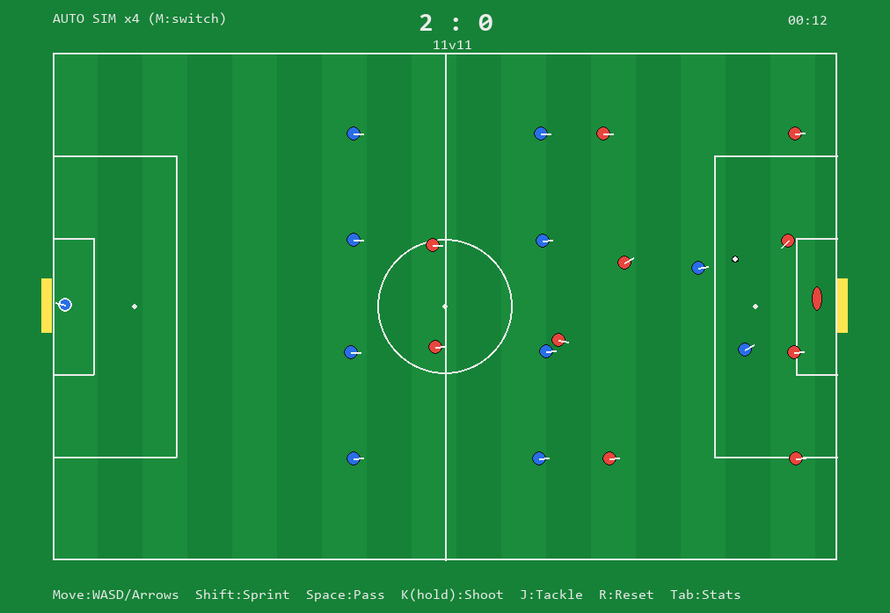
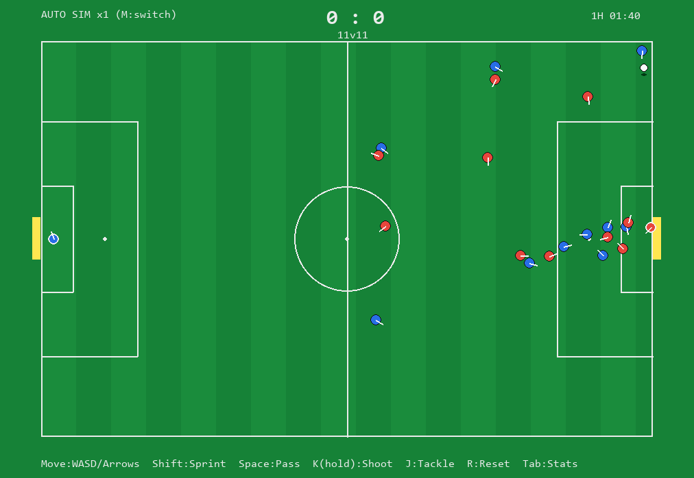
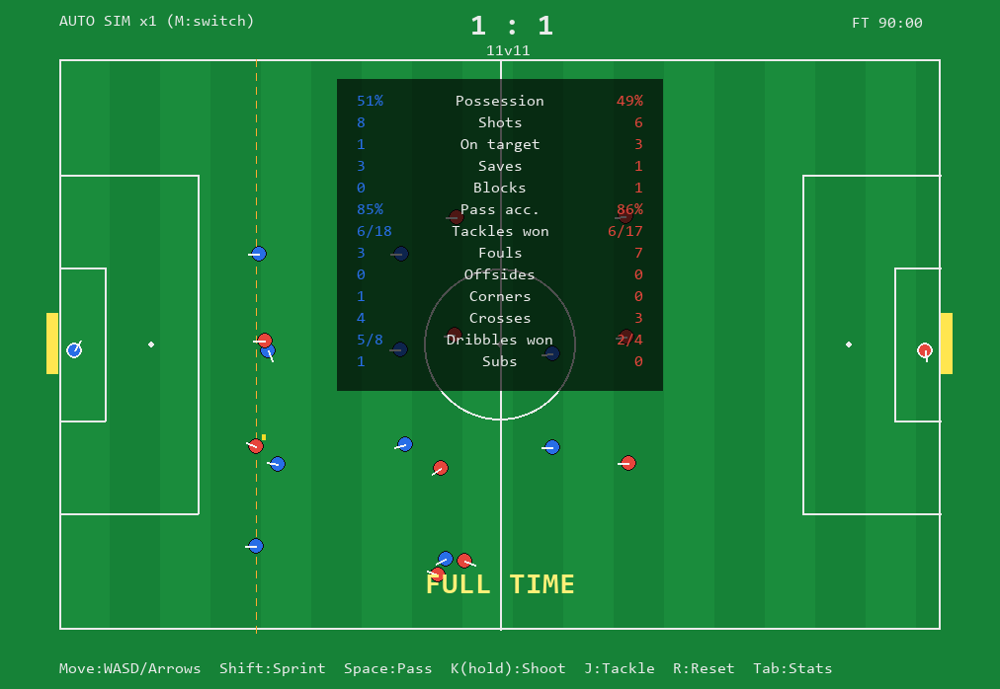
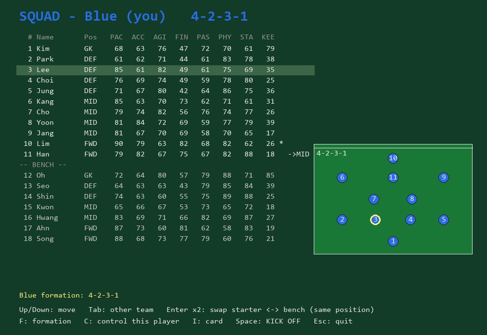
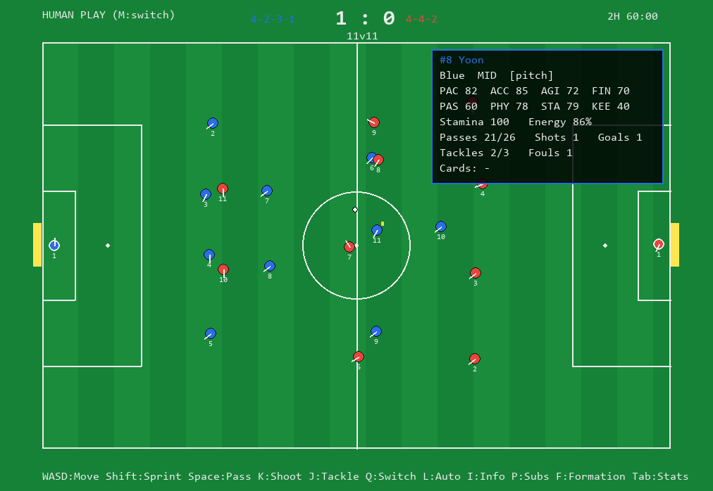
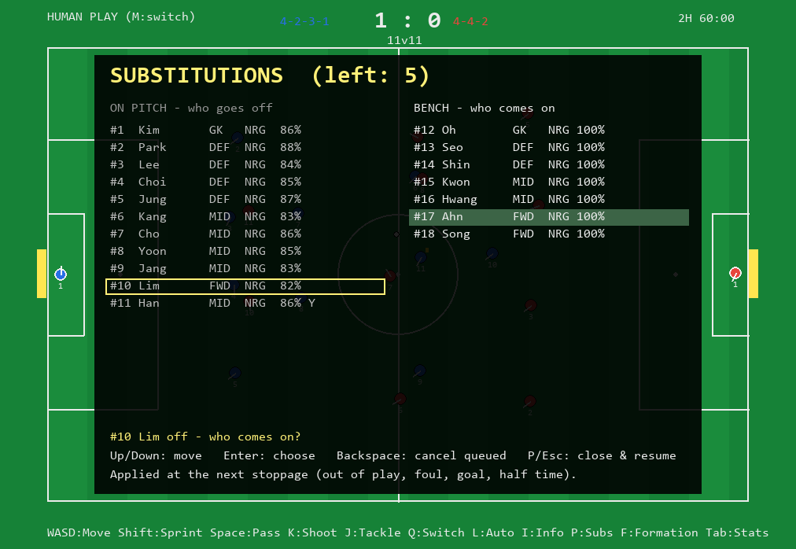

# 축구 게임 프로토타입 — 개발 문서

> 이 문서 하나로 프로젝트 전체(목표·설계·구현·실행 환경·테스트·한계·다음 단계)를 파악할 수 있도록 작성했습니다.
> 구현 파일(v4.2, Python + Pygame): **`soccer_engine.py`**(엔진 — 데이터·물리·규칙·경기 시간·스쿼드/교체·포메이션) · **`soccer_ai.py`**(AI — 판단·움직임·세트피스 루틴·AI 감독) · **`soccer_ui.py`**(화면) · **`soccer.py`**(실행 진입점, 두 모듈을 다시 내보냄)
> 테스트: **`tests/test_rules.py`**(규칙 25개) + **`tests/test_v4.py`**(AI·세트피스·경기 시간·지표 13개) + **`tests/test_squad.py`**(스쿼드·교체·선수 정보 16개) + **`tests/test_formation.py`**(포메이션·엔진/AI 분리 17개) — pytest 71개, 시드 고정
> 의존성 파일: **`requirements.txt`**
> 마지막 검증(2026-10-30, Windows 11 · Python 3.11.9 · pygame 2.6.1): pytest 71개 통과, 시드 10개 × 90분 경기 헤드리스 무오류(v4.2 재측정), 엔진/AI 분리 전후 시드 고정 시뮬 결과 동일, 실제 창(GUI) 렌더링 스크린샷 확인.

---

## 1. 목표

스탯(골 결정력·피지컬·속도 등)이 주어졌을 때 돌아가는 축구 게임을 만든다. 두 가지 플레이 방식을 **하나의 엔진**으로 지원한다.

- **사람 플레이 모드** — 사람이 한 선수를 직접 조작, 나머지 21명은 AI. 최대한 실사에 가깝게.
- **자동(매니저) 모드** — 22명 전부 AI로 경기가 자동 진행. 사람은 지켜보거나(향후) 전술만 지정.

핵심 관심사는 **"사람이 플레이할 때의 실사성"** 이며, 실사성의 대부분은 그래픽이 아니라 시뮬레이션 로직에 있다는 전제로 설계했다.

---

## 2. 기술 선택과 근거

| 항목 | 선택 | 근거 |
|---|---|---|
| 언어/라이브러리 | Python + Pygame | 빠른 프로토타이핑, 로직 검증에 적합 |
| 시점 | 2D 탑다운(위에서 내려다봄) | 구현 난이도 낮고 전술·물리 검증에 집중 가능 |
| 내부 상태 모델 | **2.5D** (피치 평면 x, y + 공 높이 z) | 렌더러와 분리 — 나중에 3D로 그래픽만 교체 가능 |
| 최종 목표 그래픽 | 3D(FIFA 스타일) | **시뮬레이션 검증 후** Ursina/Panda3D로 렌더만 교체 |

> **핵심 결정**: 경기는 평면(x, y) + 공의 높이(z)로 시뮬레이션한다. 이 상태 모델은 렌더러에 의존하지 않으므로, 지금은 탑다운으로 그리고 나중에 같은 엔진 위에 3D 렌더를 올릴 수 있다. **실사성의 90%는 시뮬레이션에 있고 폴리곤에 있지 않다.**

---

## 3. 아키텍처 — 한 엔진, 두 모드

설계의 중심은 **Intent(의도) 레이어**다. 매 프레임 모든 선수는 `Intent`(이동방향·스프린트·액션·파워)를 내놓고, 엔진이 그것을 **[스탯 + 물리 + 확률]** 로 해석해 상태를 갱신한다.

```
[입력 / AI]  →  Intent  →  [해석: 스탯 + 확률]  →  [물리 적분]  →  [규칙]  →  [렌더]
```

사람 입력은 "AI 대신 Intent를 만드는 또 하나의 브레인"일 뿐이다. 따라서 엔진·물리·규칙·렌더가 그대로 공유된다.

- **사람 플레이 모드**: 사람 컨트롤러 1명 + AI 컨트롤러 21명
- **자동 모드**: AI 컨트롤러 22명

이 분리 덕분에 두 모드를 한 코드베이스(`step()` 함수)로 돌린다.

### 파일 구성 (v4.2)

```
soccer.py          실행 진입점(simulate · run_test · main). `import soccer`로 엔진·AI 함수를 모두 쓴다
 ├─ soccer_engine.py  엔진: 데이터 모델 · 물리 · 액션(스탯→확률) · 규칙 · GK 선방 · 경기 시간/피로
 │                    · 스쿼드/교체 규칙 · 포메이션 · step()            (화면 없음, 약 1,330줄)
 ├─ soccer_ai.py      AI: xG · 패스 길목/기대값 · 볼 소유 판단 · 수비 조직 · 공 없는 움직임
 │                    · 세트피스 루틴 · AI 감독(교체·전술) + AI 전용 상수 37개    (약 620줄)
 └─ soccer_ui.py      화면: 렌더 · 선발 선택 화면 · 선수 카드 · 교체 패널 · 메인 루프 (약 500줄)
```

- **엔진 → AI**는 정해진 6곳만 부른다: `step()`의 의도(`ai_intent`)·마킹(`assign_marks`)·세트피스(`setpiece_ready`, `take_setpiece`), 사람 Space 패스의 자동 조준(`pass_options`), 공이 멈출 때 AI 감독(`maybe_subs`, `maybe_tactics`). 그 밖엔 AI가 엔진을 부른다(엔진 상태 읽기, 액션 실행).
- 두 모듈은 서로를 부르므로 엔진은 파일 맨 끝에서 `import soccer_ai as ai`로 불러 이름을 **호출할 때** 찾는다(순환 import 안전).
- 상수: 엔진 상수(피치·물리·GK·경기 시간·수비 라인 높이 등)는 `soccer_engine`, AI 전용(패스 판단·압박·침투 등)은 `soccer_ai` 위쪽. 튜닝은 그 모듈의 값을 바꾼다(`soccer.X`를 바꾸면 복사본만 바뀜).
- 분리는 동작을 바꾸지 않았다: 시드 고정 시뮬 3개(100초 · 90분 · 67초)의 전체 상태 지문(sha256)이 분리 전후 같다.

### 데이터 모델

| 구조체 | 핵심 필드 | 설명 |
|---|---|---|
| `Stats` | pace, accel, agility, finishing, passing, physical, stamina, **keeping** | 0~99 능력치 (keeping = GK 능력) |
| `Player` | team, role, base_fx/fy, stats, pos[x,y], vel, facing, stamina, pid, **active**, tackle_cd, react/dive/down, **run, beaten, energy** | active=False면 퇴장. 태클 쿨다운·GK 반응/다이브/쓰러짐 타이머. v4: run=공격수 침투 시간, beaten=돌파당해 뒤처진 시간, energy=경기 체력(1→) |
| `Ball` | pos[x,y,z], vel[3], owner, cooldown, last_team | z=높이, last_team=마지막 터치 팀 |
| `Intent` | move, sprint, action('pass'/'shoot'/'tackle'/**'cross'/'takeon'/'clear'**), power, **target** | 사람·AI 공통 출력. target = AI가 고른 패스·크로스 대상 |
| `Player`(v4.1) | **name, number, pos_role** | 이름·등번호·주 포지션(교체로 다른 자리에 들어가도 그대로). `role`은 지금 맡은 포메이션 자리 |
| `World` | players(22), ball, score, time, owner, controlled, offside_suspects, attack_team, cards, events, shot, penalty_pending, advantage, pending_pass, match, **pass_to, owner_t, marks, aerial, setpiece, match_len, half, finished** | 경기 전체 상태. v4: pass_to=패스 받을 선수, owner_t=공 가진 시간, marks=마킹 배정, aerial=날아가는 크로스, setpiece=세트피스 루틴, match_len=경기 길이. v4.1: **bench, subbed_off, sub_queue, sub_log, sub_policy, pstats, reds, human_pick, team_names** — 벤치·나간 선수·교체 대기열·교체 기록·팀별 AI 교체 정책·선수별 기록·퇴장·조작 고정 |

포메이션은 4-4-2(정규화 좌표). v4부터 `home_pos()`는 **수비 라인 하나(`def_line`)를 기준으로** 미드·공격 라인이 일정 간격으로 따라붙는다. 수비 라인은 공 위치에 따라 올라가고 내려간다(4절 표). 공 위치는 **각 팀의 공격 방향 기준으로 뒤집어서** 계산한다(v3에서 1팀이 반대로 움직이던 버그 수정).

---

## 4. 스탯 → 물리 파라미터 매핑

능력치를 그대로 쓰지 않고 물리량/확률로 변환한다. "스탯이 살아있다"는 느낌의 핵심.

| 스탯 | 반영되는 값 (코드 근사) |
|---|---|
| pace(속도) | 최대 속력 `4.5 + pace/99 × 4.5` m/s (스프린트 ×1.22) |
| accel(가속) | 가속도 `18 + accel/99 × 22` m/s² |
| agility(민첩) | 고속에서 방향전환 허용량(turn cap) `0.35 + 0.65 × agility/99` |
| finishing(결정력) | 슛 각도 오차 σ `(1 − finishing/99) × 11°` |
| passing(패스) | 패스 각도 오차 σ `(1 − passing/99) × 9°` |
| physical(피지컬) | 태클 승률 로지스틱 `0.2 + 0.6 × σ(0.08 × (수비−공격))` |
| stamina(스태미나) | 스프린트 소모율/회복. fatigue 계수(0.55~1.0)로 **속도·가속**을 깎는다 |
| keeping(GK) | 반응 지연 `0.30 − 0.18 × keeping/99` 초, 다이브 속도 `4 + 3 × keeping/99` m/s, 선방·캐치 확률 |

추가 보정: 슛 오차는 **기본 8.5°**(v3 3°) + **압박(3m 내 상대 수) ×4°** + **불균형(현재 속력 초과분) +α°** 만큼 커진다. 실패한 태클은 **접근 속도가 빠를수록 반칙 확률↑**.

### v4 추가 매핑

| 스탯 / 상태 | 반영되는 값 |
|---|---|
| passing(패스) | 패스 오차 σ = **기본 4.5°** + `(1 − passing/99) × 9°`. 첫 터치 실수 확률에도 들어감(기술) |
| passing(첫 터치) | 상대 속도 7 m/s 넘는 공: 실수 확률 `(속도 − 7) × 2.4% × (1.5 − passing/99)` + 2m 안 상대 있으면 +6%. 실수하면 공이 2~5 m/s로 옆으로 튐 |
| agility·pace vs agility·physical | 1대1 돌파 성공 `0.15 + 0.6 × σ(0.06 × (공격 − 수비))` → 같으면 45%. 성공하면 수비가 0.7초 뒤처짐 |
| physical(헤더) | 크로스 공중 경합 가중치 `(0.3 + physical/99) × (1 − 0.5 × 거리/1.2m)`. GK는 박스 안에서 손으로 `0.4 + 1.2 × keeping/99` |
| stamina·energy(컨디션) | 컨디션 = `(0.5 + 0.5 × stamina/100) × energy`. 패스·슛·헤더 오차 × `1 + 0.8 × (1 − 컨디션)`, 첫 터치 실수도 같은 배수, 돌파 성공률 ÷ 같은 배수. 속도·가속 × `(0.8 + 0.2 × energy)` |
| stamina 스탯(경기 체력) | 경기 1분마다 energy −`0.0035 × 운동량(스프린트 1.6) × (1.3 − 0.6 × stamina/99)`. 하프타임 +0.06 |

### v4 AI 판단 상수 (`soccer_ai.py` 상단, 이름 그대로 — 엔진 쪽은 `soccer_engine.py`)

| 상수 | 값 | 뜻 / 정한 이유 |
|---|---|---|
| `shot_xg()` | 로지스틱(−0.35 − 0.15×거리 + 2.0×골대 보이는 각도) × 0.8^(슛 길 위 수비 수) | 중앙 11m ≈ 0.33, 20m ≈ 0.07, 25m ≈ 0.03 — 공개 xG 모델과 비슷한 크기 |
| `SHOT_XG_MIN` / `SHOT_XG_PRESSED` | 0.035 / 0.02 | xG가 이 이상이면 슛(압박·2.5초 막힘이면 낮은 쪽). 0.07이면 경기당 슛 5개뿐이었음 |
| `PASS_SPEED_*` | 8 + 0.55×거리, 최대 22 m/s | v3는 거리×1.6(평균 25 m/s)이라 받는 사람을 지나쳐 나감 |
| `OPP_CLOSE_SPEED`, `OPP_REACT`, `LANE_MARGIN`, `LANE_END` | 3 m/s, 0.2초, 1.5m, 0.85 | 패스 길목 위험: 공이 그 지점에 오기 전에 상대가 닿을 수 있나. 마지막 15%는 받는 사람이 지킴 |
| `VAL_PROG`, `VAL_XG` | 1.5, 2.0 | 위치 가치 = 1.5×전진도² + 2×xG. 직선(전진도 그대로)이면 옆·뒤 패스만 돌렸음 |
| `LOSS_COST` | 0.20 × (1.5 − 전진도) | 뺏길 때 손해. 우리 골대 앞일수록 크고 상대 진영에선 과감하게 |
| `TOUCH_TIME` | 0.8초(압박 시 40%) | 받고 고개 들어 다음 동작까지. 없으면 0.35초마다 패스해 압박이 무의미 |
| `HOLD_PATIENCE` | 4초 | 공을 오래 끌수록 '지키기' 가치를 30%까지 낮춰 패스·크로스를 고르게 함 |
| `LINE_SLOPE`, `LINE_DEF_*`, `LINE_ATT_*` | 0.75, 수비 시 −0.12 / 10~45%, 공격 시 −0.05 / 15~55% | 수비 라인 = 0.75 × 공 위치 + OFS. 공이 우리 박스 → 10.5m, 하프라인 → 27m, 상대 진영 끝 → 47m |
| `ROLE_GAP` | 미드 +17%, 공격 +34%(공격 시 ×1.15) | 라인 간격 ≈ 18m · 36m (콤팩트 4-4-2) |
| `MARK_ZONE`, `MARK_RANGE`, `MARK_DIST` | 40m, 15m, 1.8m | 우리 골대 40m 안 상대만 맨마킹(자기 자리 15m 안), 상대의 골대·공 쪽 1.8m |
| `JOCKEY_DIST`, `TACKLE_REACH`, `TACKLE_RATE` | 1m, 1.6m, 초당 1.5회 | 압박 수비는 공 앞을 막고 기회를 봐서 태클. v3는 2m 안이면 쿨다운마다 무조건 → 태클이 패스의 48% |
| `INTERCEPT_RANGE` | 5m | 상대 패스 경로가 이 안을 지나면 끊으러 나감 |
| `RUN_RATE`, `RUN_TIME`, `RUN_DEPTH` | 초당 0.35, 1.6초, 라인 뒤 8m | 공격수 뒷공간 침투. 타이밍이 이르면 오프사이드 |
| `OFFSIDE_JUDGE` | 2m | 패서가 라인보다 2m 이상 앞선 동료는 오프사이드로 알아보고 안 줌. 아슬아슬하면 못 알아봄 |
| `CLEAR_ZONE` | 35% | 우리 진영에서 압박받고 패스 길이 없으면 측면으로 길게 걷어냄 |
| `TAKEON_ZONE` | 40% | 상대 진영 쪽에서만 1대1 돌파 시도(기대값이 패스·지키기보다 클 때) |
| `CROSS_ZONE_X`, `CROSS_Z` | 상대 골라인 28% 안 + 박스 폭 밖, 1.7m | 측면 깊은 곳에서 박스 안 동료에게 머리 높이로 크로스 |
| `GK_SAVE_BASE` | 0.40 (v3 0.45) | GK 선방 식의 기본값. 슛이 좋은 자리에서 나오면서 선방률 조정 |
| `RED_P`, `YELLOW_P` | 1%, 17% (v3 4%, 21%) | 반칙당 카드. v3 비율로 90분을 돌리면 10경기 레드 7장

GK 선방 확률(슛 1번당 1회 판정):

```
p = 0.35 + 0.55·keeping/99 − 0.40·(손 뻗는 거리/닿는 범위) − 0.012·(공 속도 − 20)
    − 0.10(공이 1.9m 위) − 0.25(페널티: 미리 몸을 던져 공을 끝까지 못 봄)      (5%~95%로 제한)
```

손 뻗는 거리 = 공 진행선과 GK 사이 최단거리. 선방 뒤에는 캐치(GK 소유) / 옆으로 쳐냄(리바운드) / 크로스바 위로 쳐냄(코너킥) 중 하나.

---

## 5. 실사화 기법(구현됨)

1. **독립 물리 공** (`step_ball`) — 공은 발에 붙지 않는다. 소유 중에는 발 앞을 스프링처럼 추종(빠를수록 터치가 느슨해짐 = 터치감). 자유 볼은 중력·공기저항·바운스(반발계수)·구름저항을 받는다.
2. **선수 관성** (`step_player`) — 즉시 멈추거나 급회전 불가. 가속/감속 + 고속에서 방향전환 제한(민첩). 스태미나로 후반 능력 저하.
3. **결과 = 의도 + 스탯 + 상황 + 확률** — 슛/패스/태클 모두 결정론이 아니라 가우시안 오차·로지스틱 확률로 처리.
4. **오프더볼 AI** (`ai_intent` + `home_pos` + `separation`) — 진형 슬라이드, 최근접 1명 압박, 선수 간 분산(뭉침 방지), 공격수의 오프사이드 라인 유지.
5. **자동 선수 전환** (`select_controlled`) — 사람 모드에서 볼 소유 선수(또는 공에 가장 가까운 우리 팀 선수)로 조작 대상이 자동 전환(FIFA식).
6. **동시 판단** (`step`) — 22명이 같은 순간의 상태를 보고 의도를 정한 뒤, 패스/슛/태클은 **매 프레임 무작위 순서**로 처리한다. 예전엔 리스트 순서대로 판단·실행해서 0팀 볼 소유자가 항상 1팀 태클보다 먼저 패스했다(1팀 태클 0회).
7. **GK 선방** (`gk_shot_intent`, `gk_save`) — 슛 순간 반응 지연 → 공 궤적 예측 지점으로 이동 → 가까워지면 다이브(조작 불가, 다이브 후 0.7초 쓰러짐). 평소엔 골대 중앙과 공을 잇는 선 위에서 공이 가까울수록 앞으로 나와 각을 좁힌다.
8. **살아있는 슛** (`world.shot`, `try_block`) — 9 m/s 이상 날아가는 슛은 필드 선수가 '받지' 못하고 몸으로 막기(블록)만 가능. 예전엔 1.5m 안 아무나 공을 흡수했다.

**v4 — AI 판단**

9. **슛 판단 = xG** (`shot_xg`) — 거리·골대가 보이는 각도·슛 길 위 수비 수로 기대득점을 계산해 문턱(0.035, 압박받거나 2.5초 막히면 0.02) 이상이면 슛. v3는 "22m 안이면 무조건 슛"이었다.
10. **패스 판단 = 기대값** (`pass_options`, `lane_risk`, `pos_value`) — 동료마다 ① 움직이는 쪽으로 앞에 주는 목표점 ② 길목 위험(공이 오기 전에 상대가 닿을 수 있나 + 목표점에 상대가 먼저 닿나) ③ 거리 위험으로 성공 추정을 내고, `성공 × 위치 가치 − 실패 × 뺏길 때 손해`가 가장 큰 곳에 준다. 사람의 Space 패스도 같은 자동 조준을 쓴다.
11. **볼 가진 선수의 선택** (`ai_on_ball`) — 받고 0.8초(압박 시 0.32초)는 몸으로 지키고, 그 뒤 슛 → 크로스(측면 깊은 곳) → 1대1 돌파(`do_takeon`) → 패스 → 걷어내기(우리 진영에서 막힘) → 드리블(앞 상대를 비켜서) 중 기대값이 가장 큰 것을 고른다. 공을 오래 끌수록 '지키기' 가치가 줄어든다.
12. **수비 조직** (`def_line`, `assign_marks`, `ai_intent`) — 수비 라인이 공 위치를 따라 오르내리고, 우리 골대 40m 안 상대는 가까운 수비가 맨마킹(골대·공 쪽에 붙음), 가장 가까운 1명은 공 앞을 막으며(지연) 초당 1.5회꼴로 태클. 상대 패스가 5m 안을 지나가면 끊으러 나간다. 공 가진 선수는 **태클로만** 뺏긴다(v3는 더 가까이 붙기만 해도 소유권이 넘어감).
13. **공 없는 움직임** (`forward_run`, `support_player`/`open_spot`, `box_run_spot`, `intercept_point`) — 공격수는 오프사이드 라인 1m 안쪽에서 기다리다 가끔 라인 뒤로 침투(이르면 오프사이드), 가장 가까운 미드 1명은 볼 주변 11m의 빈 곳으로 패스 길을 만들고, 측면 크로스 각이 나면 공격수 2명 + 먼 쪽 미드가 박스로 들어간다. 패스 받을 선수는 공 경로로 마중 나간다.
14. **첫 터치** (`bad_touch`) — 빠른 공일수록·기술이 낮을수록·상대가 붙어 있을수록·지칠수록 공이 발에서 튄다. 실제 패스 실패의 큰 몫(받는 쪽 실수)을 만든다.
15. **크로스·헤더** (`do_cross`, `lofted_kick`, `aerial_contest`, `do_header`) — 크로스는 목표 지점에 머리 높이(1.7m)로 떨어지게 띄운다(체공 시간 T → 수직 속도 `(z + ½gT²)/T`). 머리 높이(1~2.6m)를 지날 때 1.2m 안 선수들이 피지컬 가중으로 한 번 경합하고, 박스 안 GK는 손으로 잡는다(`GK CLAIM`). 공격이 이기면 14m 안이면 헤더 슛, 멀면 떨궈 주기, 수비가 이기면 걷어내기.

---

## 6. 구현된 규칙

### 6.1 득점
공이 골라인을 넘고 골대 폭 안 + 크로스바(2.44m) 아래면 득점 → 킥오프.

### 6.2 오프사이드 (`offside_line` / `mark_offside` / `update_possession`)
- 공을 **차는 순간** 상대 **2nd-last 수비수**의 x좌표를 오프사이드 라인으로 잡는다.
- 그 라인보다 앞 + 공보다 앞 + 상대 진영에 있던 동료를 "용의자"로 표시.
- 용의자가 **그 패스를 처음 컨트롤**하면 오프사이드 → 수비팀 간접 프리킥.
- 세트피스(스로인·코너·골킥) 직후 첫 플레이는 오프사이드 면제.
- **선방·블록 리바운드**: GK가 쳐낸 공이나 수비가 몸으로 막고 튄 공은 '수비의 의도적 플레이'가 아니므로 용의자를 지우지 않는다 → 슛 순간 오프사이드 위치였던 선수가 리바운드를 잡으면 오프사이드(이득 취득). GK가 **잡으면** 용의자는 지워진다.
- 화면: 공 가진 팀의 오프사이드 라인을 **주황 점선**으로 표시. AI 공격수는 이 라인을 넘지 않게 움직인다.

### 6.3 파울 · 카드 · 어드밴티지 (`do_tackle` → `award_foul` → `give_card`, `update_advantage`)
- 태클은 한 번 시도하면 **0.9초 쿨다운**(예전엔 붙어 있는 동안 매 프레임 = 초당 60번 시도).
- 태클 실패 시 반칙 확률(`0.35 + 접근속도 보정`).
- 박스 안 → **페널티킥**. 박스 밖 → **프리킥**(상대 9.15m 밀어냄).
- **어드밴티지**: 반칙당한 선수가 공을 지켰고 상대 진영이면 75% 확률(심판 재량)로 "ADVANTAGE" 선언 후 계속 진행. **3초 안에 상대에게 뺏기면** 원래 반칙 지점 프리킥("ADV CALLED BACK"), 3초가 지나거나 슛까지 가면 그대로 진행.
- 카드: 레드 1%, 옐로 17%(반칙 기준, v3 4%·21%). **옐로 2장 = 퇴장**. 어드밴티지여도 카드는 즉시 준다(단순화).
- 퇴장 시 해당 팀은 인원이 줄고(HUD `11v10` 표시), AI/소유/렌더에서 모두 제외. 카드 받은 선수 옆에 노란 마크.

### 6.4 세트피스 (`rules`)
| 상황 | 판정 | 재개 |
|---|---|---|
| 사이드라인 아웃 | 스로인 | 마지막 터치 상대 팀 |
| 골라인 아웃 + 수비가 마지막 터치 | 코너킥 | 공격 팀, 가까운 코너 |
| 골라인 아웃 + 공격이 마지막 터치 | 골킥 | 수비 팀, 골에어리어 |

스로인·골킥·먼 프리킥은 해당 팀의 최근접 선수에게 자동으로 공을 넘겨 재개한다. 이벤트는 화면 중앙 배너로 잠깐 표시된다. GK가 크로스바 위로 쳐낸 공은 마지막 터치가 수비라서 코너킥이 된다. v4부터 재개한 팀이 마지막 터치 팀이 된다(코너킥이 그대로 골라인을 넘으면 골킥 — 예전엔 코너가 반복될 수 있었음).

**v4 세트피스 루틴** (`restart` → `setpiece_intent` → `take_setpiece`) — 코너킥과 상대 골대 35m 안 프리킥:
1. 최소 1.5초, 최대 6초 동안 선수들이 자리 잡는다(공은 아무도 못 만짐). 공격은 피지컬 높은 순 5명(공격·미드 3 + 수비 2)이 니어 포스트·파 포스트·페널티 스폿·골문 앞·박스 모서리로 들어가고, 나머지는 진형 유지. 수비는 박스 안 상대를 맨마킹, 나머지는 9.15m 밖.
2. 침투조가 모두 자기 지점 3.5m 안에 오면 키커가 찬다.
3. **코너 / 측면 프리킥**: 박스 안 동료 중 상대가 가장 적게 붙은 선수를 골라 머리 높이 크로스(오차 = 패스 오차 × 1.3).
4. **직접 프리킥**(28m 안 + 박스 폭 안쪽): 수비 3명이 공-골대 선 위 9.3m에 벽을 서고(주심이 세우는 시간은 생략), 키커는 GK 반대쪽 구석을 노려 벽을 넘기는 감아차기 대신 **띄워서** 찬다(`FREE KICK SHOT`, 슛 오차 그대로).

### 6.5 페널티킥 · GK
- 페널티 선언 시 GK는 골라인 중앙에서 대기(`penalty_pending`).
- 차는 순간 GK가 방향을 찍는다(왼 45% · 가운데 10% · 오른 45%) → 반응 지연 없이 그쪽으로 다이브.
- 측정 성공률 **81%**(v4, 300회 — v3 71%). 실제 축구는 약 75~80%. GK 로직 전에는 거의 100%였다. v4에서 GK 선방 기본값을 0.45 → 0.35로 내리면서 올라갔다(필드 슛 선방률을 실제 범위로 맞춘 대가).

### 6.6 경기 기록 (`world.match`, Tab 패널)
점유율·슛·유효슛·선방·블록·패스 성공률·태클(성공/시도)·파울·오프사이드·코너, v4부터 **크로스·헤더·돌파(성공/시도)·교체**를 팀별로 센다. 크로스는 실제 기록처럼 패스에도 포함(동료가 먼저 닿으면 성공). 걷어내기는 패스에 넣지 않는다. 게임 중 **Tab**으로 패널을 켜고 끄고, 헤드리스 테스트도 같은 기록을 출력한다.

### 6.7 경기 시간 · 하프타임 · 교체 (v4, `update_clock`, `maybe_subs`)
- `--length 600`(기본): 90분을 600초에 압축(×9). 화면 오른쪽 위 `1H 23:40` 식 경기 시계. `--length 0`이면 v3처럼 끝없이.
- 첫 킥오프는 동전 던지기. 절반이 지나면 **HALF TIME**: 모두 단기 체력 100, 경기 체력 +0.06, 후반은 상대 팀 킥오프(진영 교체는 생략). 끝나면 **FULL TIME** — 상태가 멈추고 배너가 남는다. R로 새 경기.
- 골 뒤 **킥오프는 실점한 팀**이 한다(v3는 늘 같은 형태로 시작해 0팀이 먼저 잡았다).
- **교체**(v4.1부터 벤치에서): 팀당 **5명**, **공이 멈췄을 때만**(스로인·골킥·코너·프리킥·페널티 선언·골 뒤 킥오프·하프타임 — `on_stoppage`) 적용. 나간 선수는 벤치로 안 돌아가 다시 못 들어온다. **퇴장 선수는 교체로 못 채운다**(대기 중 교체 대상이 그 사이 퇴장당하면 그 교체는 취소). 들어온 선수는 나간 선수의 포메이션 자리·위치를 맡고 단기·경기 체력은 새것.
  - 요청: `request_sub(world, 팀, 나갈 pid, 벤치 번호)` → 규칙 검사(남은 교체 수는 대기열까지 셈) → 대기열 → 다음 멈춤에서 `apply_subs`. 사람·AI 공통.
  - AI 정책 `sub_policy[팀]`: `auto`(사람 모드에선 사람 팀만 끔, M으로 자동 모드면 켬) · `after_min` 55 · `energy` 0.75(경기 체력 이 아래 = 가장 지친 선수) · `yellow_risk`(60분 뒤 경고 1장 수비·미드). 들어올 선수는 같은 주 포지션 벤치 우선. 한 멈춤에 팀당 1명.
  - 기록: `SUBSTITUTION` 이벤트, `sub_log`(분·팀·나감·들어옴) — Tab 패널 아래 최근 4건, 헤드리스 출력에 `SUB 82'  Red: Jansen -> Ito`.

### 6.8 스쿼드 · 선발 · 선수 정보 (v4.1)
- 팀마다 **18명 = 선발 11 + 벤치 7**(GK 1 · 수비 2 · 미드 2 · 공격 2). 이름은 고정 목록에서(난수 안 씀 → 같은 시드 = 같은 이름), 선발 1~11번, 벤치 12~18번. 팀 이름 Blue / Red.
- **스쿼드 파일**(JSON): `{"teams": [{"name", "players": [{"name","number","role","stats"{8개}} × 18], "lineup": [등번호 11개]} × 2]}`. v4.2부터 팀별 `"formation"`(선택)도 넣을 수 있다. 선발은 **11명 · GK 정확히 1명**이면 되고(아니면 `ValueError`), 포메이션 자리에 '같은 주 포지션 우선'으로 배정된다(`assign_slots`) — 4-3-3에 공격수가 2명뿐이면 미드 1명이 공격 자리에 선다(카드에 `playing FWD`). 나머지는 벤치.
- **선발 바꾸기**(킥오프 전만, 교체 횟수 아님): `swap_lineup` — 같은 주 포지션끼리.
- **선수 카드**: `player_info(world, p)` → 이름·번호·팀·주 포지션/지금 자리·어디(경기장/벤치/교체 아웃)·능력치 8개·단기/경기 체력·이번 경기 기록(패스 성공/시도·슛·골·태클 성공/시도·반칙)·카드. 선수별 기록 `pstats`는 패스·슛·태클·반칙을 그 선수에게, 골은 마지막으로 찬 같은 팀 선수에게(자책골은 안 셈).
- **조작 선수 고정**: `human_pick`이 있으면 그 선수만 조작(고정), 없으면 v4처럼 공 가까운 선수로 자동 전환. `switch_control` = 공에 (지금 선수 다음으로) 가까운 동료로 바꾸고 고정.

### 6.9 포메이션 (v4.2, `FORMATIONS`, `set_formation`, `assign_slots`, `maybe_tactics`)
- 고를 수 있는 것: **4-4-2(기본) · 4-3-3 · 4-2-3-1 · 4-5-1 · 3-5-2 · 5-3-2**. 자리마다 (역할, 깊이 fx, 폭 fy).
- 위치 계산은 v4 그대로 '수비 라인 + 역할별 간격'이고, 자리의 깊이가 역할 기준(`ROLE_BASE_FX`: 수비 0.22 · 미드 0.46 · 공격 0.68)과 다르면 그 차이만큼 더한다 → 4-2-3-1의 수비형 미드(0.38)는 공격형 미드(0.55)보다 약 17m 뒤. 4-4-2는 기준과 같아서 v4와 위치가 똑같다.
- **바꾸기**: 킥오프 전(선발 화면, 바로 새 자리로 정렬)과 **경기 중 아무 때나**(실제로도 전술 변경엔 멈춤이 필요 없다) — 뛰고 있는 선수를 새 자리에 다시 배정한다. 지금 맡은 역할이 같은 자리 우선 → 주 포지션 → 가까운 폭·깊이 순. 경기 중 변경은 `formation_log`와 `FORMATION 4-3-3` 같은 이벤트로 남는다.
- **퇴장으로 10명이 되면**: 멈출 때 AI 감독이 같은 포메이션으로 다시 배정하면서 **가장 앞 자리(공격)부터 비운다** — 예전엔 퇴장당한 수비 자리가 그대로 빈 채였다.
- **AI 전술**(팀별 정책 `sub_policy`의 `tactics`): 지고 있으면 70분 뒤 **4-3-3**, 이기고 있으면 80분 뒤 **5-3-2**로 한 번씩 바꾼다(`chase_after`·`chase_formation`·`protect_after`·`protect_formation`으로 설정). 사람 모드에선 사람 팀 전술은 사람이(F), M으로 자동 모드면 AI가.

---

## 7. 실행 환경 및 의존성

### 7.1 요구 사항

| 항목 | 요구 / 권장 | 검증 버전 |
|---|---|---|
| Python | 3.8 이상 (f-string·dataclasses·`min(default=)` 사용) | **3.10.12**, **3.11.9** |
| pygame | 2.6 이상 | **2.6.1** (SDL 2.28.4 번들) |
| 그 외 모듈 | `sys`, `math`, `random`, `argparse`, `time`, `dataclasses` | 전부 **표준 라이브러리** (별도 설치 불필요) |
| 테스트(선택) | pytest | **9.1.1** — 게임 실행엔 필요 없음 |
| OS | Windows / macOS / Linux | Linux(Ubuntu 22.04), **Windows 11**에서 검증 |
| 하드웨어 | 일반 PC면 충분 (22 에이전트 60FPS, GPU 불필요) | — |

> 외부 의존성은 **pygame 하나뿐**입니다. pygame 설치 시 SDL 등 네이티브 백엔드가 휠(wheel)에 포함되어 함께 설치되므로 별도 SDL 설치는 필요 없습니다.

### 7.2 설치

```bash
# 방법 1) requirements.txt 사용
pip install -r requirements.txt

# 방법 2) 직접 설치
pip install pygame
```

가상환경 권장:

```bash
python -m venv .venv
# Windows:  .venv\Scripts\activate
# macOS/Linux:  source .venv/bin/activate
pip install -r requirements.txt
```

`requirements.txt` 내용:

```
pygame>=2.6
```

---

## 8. 실행 방법과 조작

```bash
python soccer.py
```

| 입력 | 동작 |
|---|---|
| WASD / 화살표 | 이동 |
| Shift | 스프린트(스태미나 소모) |
| Space | 패스(자동 조준) |
| K (꾹 눌렀다 떼기) | 슛 — 누른 시간만큼 파워 차징 |
| J | 태클 |
| M | 사람 ↔ 자동 모드 전환 |
| + / − | 자동 모드 시뮬 속도(×1~8) |
| R | 킥오프로 리셋(경기가 끝났으면 새 경기) |
| Tab | 경기 기록 패널 켜기/끄기(아래에 최근 교체 4건) |
| **Q** | 조작 선수 바꾸기 — 공에 다음으로 가까운 동료로, 그리고 **고정**(노란 원이 굵어지고 `[LOCK]`) |
| **L** | 고정 풀기 — 공 가까운 선수로 자동 전환(기본) |
| **I** | 선수 카드 켜기/끄기 — 조작 선수(자동 모드면 공 가진 선수) |
| **마우스 왼쪽 클릭** | 클릭한 선수의 카드 |
| **F** | 우리 팀 포메이션 바꾸기(4-4-2 → 4-3-3 → 4-2-3-1 → 4-5-1 → 3-5-2 → 5-3-2 → …, 바로 적용) |
| **P** | 일시정지 + 교체 패널: ↑↓ 나갈 선수 · Enter → ↑↓ 들어올 벤치 선수 · Enter = 대기열(다음 멈춤에서 적용, 화면에 `SUB PENDING`) · Backspace 대기 취소 · P/Esc 닫고 계속 |
| Esc | 종료 |

**킥오프 전 선발 선택 화면**(기본으로 뜸, `--no-select`로 건너뜀): 한 팀의 18명(선발 11 + 벤치 7)과 능력치 8개 표.

| 입력 | 동작 |
|---|---|
| ↑ / ↓ | 선수 이동 |
| Tab | 다른 팀 보기(상대 팀 선발도 바꿀 수 있음) |
| Enter 두 번 | 선발 1명 ↔ 같은 포지션 벤치 1명 맞바꾸기 |
| F | 보고 있는 팀의 포메이션 바꾸기(오른쪽 아래 미리보기, 주 포지션과 다른 자리면 `->MID` 표시) |
| C | 이 선수를 내가 조작(우리 팀 필드 선발만, `*` 표시 = 고정) |
| I | 선수 카드 켜기/끄기 |
| Space | 킥오프 |
| Esc | 종료 |

사람 모드에선 **우리 팀 교체는 사람이**(AI 자동 교체 꺼짐), 상대 팀은 AI 정책대로. M으로 자동 모드로 바꾸면 우리 팀도 AI가 교체한다.

실행 옵션:

```bash
python soccer.py                 # 90분을 600초(10분)에 — 기본
python soccer.py --length 300    # 90분을 300초에(×18)
python soccer.py --length 0      # 시간 제한 없음(v3 방식)
python soccer.py --no-select     # 선발 선택 화면 건너뛰기
python soccer.py --formation 4-3-3,5-3-2   # v4.2: 0팀,1팀 포메이션(하나만 쓰면 두 팀 같게)

# v4.1 스쿼드 파일: 자동 스쿼드를 저장 → 이름·능력치·lineup을 고쳐서 → 그 스쿼드로 경기
python soccer.py --export-squad my_squad.json --seed 7
python soccer.py --squad my_squad.json                      # GUI
python soccer.py --match --squad my_squad.json --seed 1     # 헤드리스 90분
```

화면: 점수 양옆에 팀별 포메이션, 오른쪽 위 경기 시계(`1H`/`2H`/`FT`), 아래 조작 선수 정보에 `STA`(단기 체력)·`NRG`(경기 체력 %). 코너·공격 지역 프리킥은 사람 팀도 자동 루틴으로 찬다.








---

## 9. 테스트 환경 및 검증

### 9.1 검증 환경

| 항목 | v1~v2 | v3 · v4 (2026-10-30) |
|---|---|---|
| OS | Ubuntu 22.04 (헤드리스 Linux 샌드박스) | Windows 11 Pro |
| Python | 3.10.12 | 3.11.9 |
| pygame / SDL | 2.6.1 / 2.28.4 | 2.6.1 / 2.28.4 |
| 디스플레이 | 없음 — `SDL_VIDEODRIVER=dummy` | 헤드리스 + 실제 창(`windows` 드라이버) |
| pytest | — | 9.1.1 |

### 9.2 헤드리스 스모크 테스트

디스플레이 없이 자동 시뮬을 N스텝 돌려 런타임 오류와 규칙 동작을 검증한다. `run_test()`가 점수·잔여 인원·이벤트 카운트·**1스텝 평균 시간**·**경기 기록**을 출력한다. `--seed`를 주면 같은 경기가 그대로 재현되고, 쉼표로 여러 개를 주면 시드마다 한 경기씩 돈다.

```bash
# 화면 없이 6000스텝(=시뮬 100초) 자동 경기
python soccer.py --test 6000

# 시드 고정 3경기(각 200초), 완전 헤드리스
SDL_VIDEODRIVER=dummy SDL_AUDIODRIVER=dummy python soccer.py --test 12000 --seed 1,2,3
# Windows PowerShell:  $env:SDL_VIDEODRIVER="dummy"; python soccer.py --test 12000 --seed 1,2,3

# v4: 90분 경기(600초 압축)를 종료 휘슬까지, 시드 2개
python soccer.py --match --seed 1,2
python soccer.py --match --length 240 --seed 1,2,3   # 더 빨리(90분 = 240초)
```

`--test N`은 v3처럼 **시간 제한 없이** N스텝(경기 체력 감소·교체 없음), `--match`는 하프타임·종료·교체까지 있는 한 경기다.

출력 예시(v4, `--test 6000 --seed 2` — 100초. v3는 같은 조건에서 슛이 이보다 10배 넘게 많았다):

```
TEST OK  seed=2  score=[1, 0]  players=11v11  events={'ADVANTAGE': 1, 'GOAL': 1, 'THROW-IN': 2}  time=100s  step=0.73ms
         poss 59-41%  shots 1-0  on-target 1-0  saves 0-0  blocks 0-0  pass% 91-85  tackles 0-1/0-3  fouls 0-1  offsides 0-0  crosses 0-2  subs 0-0
```

### 9.3 자동 테스트 (pytest)

```bash
pip install pytest          # 테스트할 때만
python -m pytest tests -q   # GAME/Soccer 폴더에서, 약 3~6분(PC 부하에 따라)
```

| 묶음 | 확인 내용 |
|---|---|
| 득점·세트피스 | 골 → 점수+킥오프, 크로스바 위 → 골킥, 수비 마지막 터치 → 코너, 사이드라인 → 상대 스로인 |
| 오프사이드 | 라인 넘은 선수 → OFFSIDE, 라인 안쪽 → 정상 소유, 세트피스 첫 플레이 면제, **GK가 쳐낸 리바운드도 오프사이드**, GK 캐치 시 해제 |
| GK | 캐치/쳐냄/실패 분기, 멀고 빠른 슛일수록 선방률↓(v4: 쉬운 슛 기준 0.75 → 0.70, GK 기본값을 낮춘 만큼), 수비 블록, **PK 성공률 55~92% 범위** |
| 파울·어드밴티지 | 박스 안 PK, 박스 밖 FK + 9.15m, 어드밴티지 후 뺏기면 원위치 FK, 지키면 진행, 태클 쿨다운, 패스 성공 집계 |
| 전체 경기 | 같은 시드 = 같은 결과, 시드 3개 무오류·스텝 8ms 미만, **시드 5개 점유율 38~62%**(공정성), 사람 모드 15초 |
| v4 AI 판단 (`test_v4.py`) | 길이 열리면 앞 동료, **길목이 막히면 다른 동료**를 고름(AI 실제 Intent까지), 확실한 오프사이드 동료는 안 고름, **수비 라인이 공 따라 오르내림**(10.5m~47m, 공 가지면 더 높게), 1팀도 좌우 대칭, xG 대칭·크기(1팀 각도 버그 재발 방지) |
| v4 세트피스 | **코너: 박스 침투 3명 이상 + 크로스 1회 + 공이 박스 안 머리 높이로 떨어짐**, 직접 프리킥: 수비벽(9.15m) + 슛, 코너가 그대로 나가면 골킥 |
| v4 경기 시간·피로 | **종료 휘슬**(90분, HALF TIME·FULL TIME, 종료 후 상태 고정), **지친 선수는 패스·슛 오차 1.3배 이상 + 실제 슛 방향 퍼짐도 큼**, 경기 체력 감소, 55분 뒤 교체(그 전엔 안 함) |
| v4 지표 범위 | 90분(150초 압축) × 시드 8개(한가할 때 약 45초): 패스 68~90%, 오프사이드 1회 이상, 점유율 35~65%, 슛 8개·선방 2개 이상, 골 ≤ 슛의 30%. 짧은 경기 8개의 슛 수는 같은 코드에서도 10~24개로 흔들려서 슛→골 정확한 범위는 10경기 측정(9.4)으로 본다 |
| v4.2 포메이션·분리 (`test_formation.py`) | 포메이션 6개 모두 GK 1 + 필드 10·이름과 인원 일치, 고른 포메이션으로 시작(킥오프 자기 진영), 모르는 이름 거부, 4-4-2는 v4 깊이 그대로, **4-2-3-1 수비형 미드가 공격형 미드보다 10m 이상 뒤**, 킥오프 전 변경 = 새 자리 정렬, **경기 중 변경 = 같은 11명·수비는 그대로·기록**, **퇴장 뒤 재배정(수비 4명 유지, 공격 자리 비움)**, 스쿼드 파일 포메이션(공격 자리 3개면 미드가 올라감), **AI 전술(지면 4-3-3, 이기면 5-3-2, 한 번씩, 끌 수 있음)**, **엔진 모듈에 AI·화면 함수 없음 · 엔진만으로 90분 경기** |
| v4.1 스쿼드·교체·정보 (`test_squad.py`) | 자동 스쿼드(18명·이름·번호), **스쿼드 파일의 선발 11명이 4-4-2 자리에 그대로**, 잘못된 선발 거부, 스쿼드 파일로 헤드리스 경기, 킥오프 전에만·같은 포지션만 선발 바꾸기, **조작 선수 고정/전환/해제**, **`player_info` = 엔진 상태**(선수별 패스 합 = 팀 기록), 골 기록, **교체는 멈춤에서만**(자리·체력 승계), **5명 제한**(대기열 포함), **나간 선수 복귀 불가**, **퇴장 선수 교체 불가**(대기 중 퇴장 → 취소), **90분 시뮬 AI 자동 교체**(55분 뒤, 체력 기준), 정책 끄기, 경고 누적 위험 교체 |

v4에서 기존 `test_full_match_runs_and_is_sane`의 "100초 안에 슛·선방이 1개 이상" 조건을 뺐다(대신 '패스가 있다'). v3는 200초에 슛 27.6개(실제 축구의 약 14배)라 늘 성립했지만, 실제 축구는 100초에 슛 0.5개꼴이고 v4도 그 근처다. 슛·선방 수는 지표 범위 테스트가 여러 경기로 본다.

확률이 끼는 단위 테스트는 `random.random`을 정해진 값으로 바꿔 결과를 고정한다.

### 9.4 검증 결과 (v4 ~ v4.2, 2026-10-30)

- **v4.2 (포메이션 · 엔진/AI 분리)**: pytest **71개 전부 통과**(335초, 다른 앱이 CPU를 많이 쓰던 중). 엔진/AI 분리는 시드 고정 시뮬 3개의 상태 지문이 분리 전후 **완전히 같다**(동작 변화 0). 10경기 × 90분(4-4-2로 시작, AI 전술 켬 — 16번 포메이션 변경): 슛→골 **13.2%**(114슛 15골), 유효 41%, 선방 **74%**, 패스 **85.2%**, 점유 **47:53**, 오프사이드 **경기당 1.8회**, 교체 4.6명, 무오류 — v4·v4.1과 같은 범위. 섞은 포메이션(4-3-3 대 4-2-3-1, 3-5-2 대 5-3-2, 4-5-1 대 4-4-2) 각 2경기도 무오류(표본이 작아 포메이션별 강약은 아직 재지 않았다 — 13절).

- **pytest 54개 전부 통과**(기존 25 + v4 13 + v4.1 16). v4 시점 38개는 197초, v4.1 54개는 약 3분 반(다른 앱이 CPU를 77~100% 쓰던 중 — 가장 긴 건 지표 범위 테스트 약 100초, 한가할 때 약 45초).
- **v4.1 재측정**(벤치 생성으로 난수 순서가 바뀌어 같은 시드도 다른 경기): 10경기 × 90분 — 슛→골 **13.5%**(111슛 15골), 유효 40%, 선방 **73%**, 패스 **85.4%**, 점유 **47:53**, 오프사이드 **경기당 2.1회**, 교체 경기당 3.5명(이제 벤치에서), 무오류. v4 값과 같은 범위 — 기능 추가로 현실성 지표가 나빠지지 않았다.
- **무오류**: 시드 1~10 × 90분 경기(600초) + 시드 1~10 × 200초(시간 제한 없음) 예외 없음.
- **1스텝 시간**: 단독 실행 **0.73~0.95 ms**(`--test 6000 --seed 1,2,3`, 같은 부하 상태) — 60FPS 예산 16.7ms의 6% 안팎. v3 0.70 ms에서 AI 판단이 늘었지만 비싼 계산(패스 후보·차단 지점 예측)은 공 가진 선수·공 근처 선수만 한다. 병렬 7개로 돌린 측정에선 2.3~3.6 ms(예산의 22% 이하).
- **지표**(같은 시드 1~10). v3 열은 200초 연속 경기, v4는 90분 경기(600초 압축, 경기 체력·교체 포함) — 둘 다 같은 `world.match` 기록:

| 지표 | v3 (10경기 × 200초) | **v4 (10경기 × 90분)** | v4 (10경기 × 200초, 참고) | 실제 축구 | 목표 |
|---|---|---|---|---|---|
| 슛 → 골 비율 | 19% (276슛 52골) | **14.7%** (116슛 17골) | 15.8% (38슛 6골) | 약 10% | 8~15% |
| 유효슈팅 비율 | 66% | **45%** | 37% | 약 33% | — |
| GK 선방률(선방/(선방+골)) | 76% | **72%** | 65% | 약 70% | 65~75% |
| 페널티 성공률(300회) | 71% | **83%** | — | 75~80% | — |
| 점유율 0팀:1팀 | 47 : 53 | **50 : 50** | 49 : 51 | — | 균형 |
| 패스 성공률 | 52% (경기당 63회) | **85.0%** (경기당 421회) | 84.5% (140회) | 75~85% | 70~85% |
| 오프사이드 | **0회** | **경기당 1.4회** (14회) | 경기당 0.5회 | 경기당 2~4회 | 0보다 큼 |
| 경기당 슛 | 27.6 (200초에!) | **11.6** | 3.8 | 약 25 | — |
| 경기당 골 | 5.2 | **1.7** | 0.6 | 약 2.7 | — |
| 경기당 크로스 / 헤더 | — / — | **5.2 / 3.4** | 2.5 / 1.8 | 약 18 / — | — |
| 경기당 코너 | 2.2 | **1.3** | 0.4 | 약 10 | — |
| 돌파 성공 | — | **45%** (71/159) | 56% | 약 45~55% | — |
| 경기당 파울 / 카드 | 1.3 / 옐로 0.4 | **3.9 / 옐로 0.8 · 레드 0.1** | 1.8 / 0.5 | 약 22 / 옐로 4 | — |
| 경기당 교체 | — | **3.8** | 0 | 약 8~10 | — |

- 이벤트 합계(v4 90분 10경기): GOAL 17 · SAVE 43 · OFFSIDE 14 · CORNER 13 · GK CLAIM 6 · PENALTY 1 · FOUL 39 · ADVANTAGE 33 · ADV CALLED BACK 10 · YELLOW 8 · RED 1 · THROW-IN 85 · GOAL KICK 54 · SUBSTITUTION 38 · HALF TIME 10 · FULL TIME 10. 직접 프리킥 슛(`FREE KICK SHOT`)은 이 10경기엔 없었다(튜닝 중 다른 시드에선 나옴, pytest로 확인).
- 파울 수는 `FOUL` 이벤트(프리킥으로 끊긴 반칙) 기준. 어드밴티지·PK까지 합친 기록(`fouls`)은 경기당 7.3개.
- **골의 출처**(튜닝 중간 버전 — 슛 오차 7.5°·GK 기본 0.40 — 의 90분 10경기, 별도 집계): 17골 중 16골이 '유효 슛 → GK 못 막음', 1골이 선방 리바운드. 선방 수가 '유효슛 − 골'보다 많은 건 빗나갈 슛도 GK가 막기 때문(버그 아님).
- **해석**: 목표로 잡은 비율 지표(슛→골·선방·패스·점유·오프사이드)는 모두 목표 범위 안이다(슛→골·패스는 범위 상단). 대신 **양**(경기당 슛·골·코너·크로스)은 실제의 15~60%다 — 공격이 좋은 자리까지 가는 횟수가 아직 적다(12절). 유효슈팅 45%와 PK 83%도 실제보다 높다.
- **GUI**: 실제 창(`windows` 드라이버)으로 코너킥 루틴과 90분 경기 종료 화면(Tab 패널 + FT 시계)을 렌더링해 스크린샷 확인(8절 이미지).

### 9.5 v4 튜닝 과정에서 찾은 버그 (기록)

| 증상 | 원인 | 수정 |
|---|---|---|
| 점유율 0팀 85~93% (시드 6개 모두) | `shot_xg`의 각도를 `atan2` 두 개의 차이로 구해서, −x 방향으로 공격하는 1팀은 ±π 경계를 넘어 하프라인에서도 xG 0.98 → 1팀이 공만 잡으면 슛 | 두 골대 기둥 벡터 사이각으로 계산. 대칭 테스트 추가 |
| 점유율이 늘 시작한 팀으로 쏠림 | 골 뒤 킥오프가 늘 같은 진형(마지막 터치 팀 그대로), 첫 킥오프도 늘 0팀 | 실점한 팀이 킥오프, 첫 킥오프는 동전 던지기 |
| 사람 모드 15초 테스트에서 조작 선수가 GK | 우리 GK가 공을 잡으면 사람이 GK를 조작하게 돼 패스를 안 하고 몰고 나감(v3부터) | GK가 가진 공은 AI GK가 처리, 사람은 공에 가까운 필드 선수 |
| 패스 후보 성공 추정이 전부 0 | 패서 바로 옆(0.3m) 상대를 '모든 패스 길목 위의 상대'로 봄 | 발끝에선 공 경로 0.6m 안일 때만 막는 것으로 |
| 태클이 패스의 48% | 가장 가까운 수비가 공으로 돌진 + 2m 안이면 쿨다운마다 태클, 가까이 붙기만 해도 소유권 이동 | 지연 수비(공 앞 1m) + 초당 1.5회 확률 태클, 소유자는 태클로만 뺏김 |
| 코너킥이 그대로 나가도 또 코너 | 재개 때 마지막 터치 팀을 안 바꿈 | 재개한 팀 = 마지막 터치 팀 |

---

## 10. 코드 맵 (파일별 탐색 가이드)

**`soccer_engine.py` — 엔진**

| 영역 | 함수/구조 | 역할 |
|---|---|---|
| 상수 | 상단 `L, W, GOAL_W, …`, `LINE_*`, `ROLE_GAP`, `ROLE_BASE_FX`, 경기 시간·교체 상수 | 피치 규격·물리·수비 라인·피로 |
| 데이터 | `Stats / Player / Ball / Intent / World`, `FORMATION(S)` | 상태 모델, 포메이션 6개 |
| 팀 모양 | `World.def_line`, `World.home_pos`, `assign_slots`, `set_formation` | 수비 라인 높이 · 자리 위치 · 포메이션 배정/변경 |
| 소유권 | `update_possession`, `bad_touch`, `try_block`, `aerial_contest` | 컨트롤·첫 터치·오프사이드 발동 / 블록 / 공중 경합 |
| 물리 | `step_player`, `step_ball`, `predict_cross`, `lofted_kick` | 관성 이동(GK 다이브·돌파당함 포함) / 공 물리 / 궤적 |
| 액션 | `kick`, `do_pass`, `do_shot`, `do_header`, `do_cross`, `do_clear`, `do_takeon`/`takeon_prob`, `do_tackle`, `register_shot`, `shot_error_deg`, `pass_error_deg`, `condition(_mult)` | 의도 → 결과(스탯 + 확률 + 피로) |
| 규칙 | `rules`, `restart`, `penalty`, `offside_*`, `mark_offside`, `*_card`, `award_foul`, `update_advantage` | 득점·세트피스 시작·파울·오프사이드·어드밴티지 |
| GK | `gk_save` | 선방 판정(캐치·쳐냄) |
| 경기 시간 | `update_clock`, `game_minute` | 전후반·종료 |
| 교체 | `on_stoppage`, `request_sub`, `apply_subs`, `subs_left`, `find_player` | 멈춤에서만 적용, 규칙 검사 |
| 스쿼드·정보 | `name_squad`, `load_lineup`, `load_squad`, `squad_dict`, `swap_lineup`, `pstat`, `player_info` | 18명 스쿼드·JSON·선발 바꾸기·선수 카드 |
| 사람 입력 | `human_intent`, `select_controlled`, `switch_control` | 사람 조작, 조작 선수 고정 |
| 통합·기록 | `step`, `new_match_stats`, `possession_pct`, `match_summary` | 1프레임(동시 판단 → 무작위 순서 실행), 경기 기록 |

**`soccer_ai.py` — AI**

| 영역 | 함수 | 역할 |
|---|---|---|
| 판단 | `shot_xg`, `pass_speed`, `lane_risk`, `pos_value`, `loss_cost`, `offside_obvious`, `pass_options`, `cross_target`, `in_cross_zone`, `front_defender`, `ai_on_ball` | xG·패스 기대값·크로스·돌파 → 볼 소유 선택 |
| 움직임 | `ai_intent`, `move_to`, `separation`, `assign_marks`, `intercept_point`, `near_ball_path`, `forward_run`, `support_player`/`open_spot`, `box_run_spot`, `box_spots`, `aerial_point`, `gk_shot_intent` | 수비 조직·침투·지원·박스 침투·GK |
| 세트피스 | `fk_direct`, `setpiece_roles`, `wall_spot`, `setpiece_intent`, `setpiece_ready`, `take_setpiece` | 코너·프리킥 루틴 |
| 감독 | `maybe_subs`, `pick_bench`, `maybe_tactics` | 교체 정책, 전술(포메이션) 정책 |

**`soccer_ui.py` — 화면**: `draw`, `draw_stats`, `draw_card`, `select_screen`/`draw_squad`/`draw_formation`, `draw_subs`/`sub_panel_key`, `next_formation`, `game_loop`.
**`soccer.py` — 진입점**: `simulate`, `run_test`, `main`(CLI).

> 파일 나누기 이력: v4까지 한 파일(1,880줄) → v4.1 화면 분리(`soccer_ui.py`) → **v4.2 엔진/AI 분리**. 나누는 방법은 AST로 최상위 함수·상수를 '누가 쓰나'로 분류해 옮기고(AI 함수만 쓰는 상수는 AI로), 엔진의 AI 호출 6곳을 `ai.이름(...)`으로 바꿨다. 테스트·도구는 `import soccer` 그대로 쓴다.

---

## 11. 진행 이력

- **v1 (코어 엔진)**: Intent 레이어, 독립 물리 공, 선수 관성, 스탯 기반 슛/패스/태클, 스태미나, 오프더볼 AI, 사람/자동 두 모드, 기본 아웃-오브-바운드 복귀, 탑다운 렌더링. 헤드리스 테스트 통과.
- **v2 (규칙 정교화)**: 오프사이드(라인 판정), 파울·옐로/레드카드·퇴장, 프리킥/페널티, 스로인·코너·골킥 구분, 오프사이드 라인/이벤트 배너/인원수 HUD. 다회 시뮬로 GOAL·OFFSIDE·FOUL·PENALTY·YELLOW·THROW-IN·GOAL KICK 발생 및 무오류 확인.
- **문서화**: 본 개발 문서 + `requirements.txt` 작성. 실행 환경·의존성·테스트 환경 명시.
- **v3 (GK · 어드밴티지 · 경기 기록, 2026-10-30)**:
  - **GK 선방**: 반응 지연, 각 좁히기 위치, 궤적 예측 이동, 다이브/쓰러짐, 캐치·쳐냄·크로스바 위로 쳐내기, PK 방향 찍기. `keeping` 스탯 추가.
  - **규칙**: 어드밴티지(3초 관찰 후 진행/원위치 FK), 태클 0.9초 쿨다운, 살아있는 슛·블록, 선방/블록 리바운드 오프사이드.
  - **경기 기록**: 점유율·슛·유효슛·선방·블록·패스 성공률·태클·파울·오프사이드·코너. Tab 패널 + 헤드리스 출력.
  - **버그 수정 2건(공정성)**: ① `home_pos`가 1팀 기준으로 공 위치를 안 뒤집어 1팀 진형이 반대로 움직임 ② 리스트 순서대로 판단·실행해 0팀이 항상 먼저 패스 → 1팀 태클 0회. 수정 전 점유율 1팀 74~89%, 수정 후 47:53.
  - **테스트**: `--seed` 재현 옵션, 1스텝 시간 출력, pytest 25개(`tests/test_rules.py`). Windows 11 + Python 3.11.9에서 헤드리스·GUI 모두 확인.
- **v4 (AI 판단 · 세트피스 · 경기 시간, 2026-10-30)**:
  - **AI 판단**: xG로 슛 결정, 패스 길목 검사 + 기대값으로 패스 선택(사람 Space 패스도 같은 조준), 받고 0.8초 터치 시간, 공 끄는 가치 감소, 1대1 돌파, 압박 시 걷어내기, 첫 터치 실수, 패스 공 속도 현실화(평균 25 → 15 m/s).
  - **수비**: 공 위치에 따라 오르내리는 수비 라인 + 라인 간격, 우리 골대 40m 안 맨마킹, 지연 수비·확률 태클, 패스 끊으러 나가기. 소유자는 태클로만 뺏김.
  - **공 없는 움직임**: 공격수 뒷공간 침투(→ 오프사이드 발생), 미드 1명 지원 움직임, 측면 크로스 각에서 박스 침투, 패스 받을 선수가 마중.
  - **크로스·헤더**: 머리 높이 크로스, 공중 경합(피지컬·거리), 헤더 슛/떨궈 주기/걷어내기, GK 공중볼 캐치.
  - **세트피스 루틴**: 코너·공격 지역 프리킥에 박스 침투 5명·마킹·9.15m, 키커가 가장 덜 붙은 동료를 조준, 직접 프리킥은 수비벽 + GK 반대쪽 구석.
  - **경기 시간**: 90분 배속(`--length`, 기본 600초), 하프타임(체력 회복·후반 킥오프), 종료 휘슬, 경기 체력(energy), AI 교체(55분 뒤, 팀당 5명), 피로 → 패스·슛·헤더 오차·첫 터치·돌파.
  - **규칙 조정**: 실점한 팀 킥오프, 재개 팀 = 마지막 터치 팀, 카드 확률 현실화(레드 4 → 1%, 옐로 21 → 17%).
  - **버그 수정**: 1팀 xG 각도(점유율 0팀 85~93%의 원인) 외 9.5절 표.
  - **결과**(10경기): 슛→골 19 → 14.7%, 유효슈팅 66 → 45%, 선방 76 → 72%, 패스 52 → 85.0%, 점유 47:53 → 50:50, 오프사이드 0 → 경기당 1.4회. pytest 25 → 38개. Tab 패널에 크로스·돌파·교체 추가.
  - **공정성**: 첫 킥오프를 동전 던지기로(예전엔 늘 0팀), 사람 모드에서 우리 GK가 잡은 공은 AI GK가 처리(예전엔 사람이 GK를 몰고 나감).
- **v4.1 (선수 선택 · 선수 정보 · 경기 중 교체, 2026-10-30)** — 사용자 요청, 계획은 13.1절(먼저 커밋):
  - **스쿼드**: 팀당 18명(선발 11 + 벤치 7), 이름·등번호·주 포지션. 스쿼드 JSON(`--squad`, `--export-squad`), 킥오프 전 선발 선택 화면(맞바꾸기·조작 선수 고정·카드).
  - **선수 정보**: 엔진 `player_info` + 선수별 기록(`pstats`: 패스·슛·골·태클·반칙). 경기 중 I / 마우스 클릭으로 카드.
  - **교체**: 벤치에서, 팀당 5명, 멈춤에서만, 나간 선수 복귀 불가, 퇴장 자리 못 채움. 사람은 P(일시정지 패널 → 대기열), AI는 팀별 정책(체력·경고 위험). Tab 패널·헤드리스 출력에 교체 기록.
  - **조작**: Q(다음 동료로 바꾸고 고정) · L(자동 전환).
  - **코드**: 화면을 `soccer_ui.py`로 분리(렌더 분리 첫걸음). pytest 38 → 54개. 10경기 재측정에서 현실성 지표 유지(9.4).
- **v4.2 (포메이션 · 엔진/AI 분리, 2026-10-30)**:
  - **엔진/AI 분리**: `soccer_engine.py`(엔진) · `soccer_ai.py`(AI) · `soccer_ui.py`(화면) · `soccer.py`(진입점). 시드 고정 시뮬 지문이 분리 전후 같음(동작 변화 0). 따로 커밋.
  - **포메이션**: 6개(4-4-2 · 4-3-3 · 4-2-3-1 · 4-5-1 · 3-5-2 · 5-3-2), 킥오프 전·경기 중 변경(F 키 · `--formation` · 스쿼드 파일), 자리 배정(`assign_slots`), 퇴장 뒤 재배정, AI 전술(지면 4-3-3, 이기면 5-3-2). 선발 규칙은 '11명 · GK 1명'으로 완화.
  - **화면**: 선발 화면 포메이션 미리보기, HUD·Tab 패널에 포메이션.
  - pytest 54 → 71개. 10경기 재측정에서 현실성 지표 유지(9.4).

---

## 12. 알려진 단순화 / 한계

- **공격의 양이 적다**: 비율은 맞췄지만 90분에 슛 11.6개·골 1.7개·코너 1.3개·크로스 5.2개(실제 약 25·2.7·10·18). 공격이 박스 근처까지 가는 횟수가 적다 — 수비 조직(라인·마킹·지연)이 공격 움직임(지원 1명, 침투 2명)보다 촘촘하다. 풀백 오버래핑·윙어 폭 벌리기·2:1 패스(원투)가 없다.
- **패스 성공률 85.0%는 목표 상단**이고 경기당 421회로 실제(약 900회)의 절반. 패스 실패는 주로 첫 터치 실수와 길목 차단이다. 받는 쪽이 공을 놓치는 모델은 단순(공이 2~5 m/s로 튐).
- **PK 83%**로 실제(75~80%)보다 약간 높다. 필드 슛 선방률을 맞추려고 GK 기본값을 낮춘 대가 — PK 전용 보정은 아직 없다.
- **피로의 효과가 작다**: 90분 경기 끝에 경기 체력이 0.7~0.8 정도라 오차는 최대 +20~25%. 교체는 경기당 3.8명(양 팀 합, 실제 8~10명) — 기준(체력 0.75)이 보수적이다. 부상은 없다.
- **진영 교체 없음**: 후반에도 같은 방향으로 공격(대칭이라 결과엔 영향 없음, 표시만 다름).
- **세트피스**: 짧은 코너·프리킥 변형 없음, 직접 프리킥은 감아차기 없이 띄워 차기, 수비벽은 주심이 즉시 세운 것으로 단순화, 벽 점프 없음. 코너 루틴은 사람 팀도 자동.
- **오프사이드**는 "공을 만진 선수" + "선방/블록 리바운드" 기준. GK 시야 방해 같은 '상대 방해형' 적극 관여는 없음.
- GK: 1:1 전진·골킥 루틴 없음. 잡은 공은 바로 패스한다.
- 어드밴티지 중에도 카드는 즉시 준다.
- 슛 커브(마그누스) 미구현. 헤더는 '머리 높이를 지날 때 한 번 경합'이라는 근사.
- **포메이션**: 6개 고정 목록(직접 자리를 찍는 편집기는 없음). 수비 라인 높이·압박 강도 같은 **팀 지시는 아직 공통 상수**(`LINE_*`). 포메이션별 강약은 아직 재지 않았다(섞은 포메이션 6경기는 무오류만 확인). 3백·5백에서 측면 수비(윙백)의 오르내림은 다른 수비와 같은 라인 규칙을 따른다.
- **모듈 사이 상수**: AI 상수는 `soccer_ai`, 엔진 상수는 `soccer_engine`에 있어 튜닝할 모듈을 골라야 한다(`soccer.X`를 바꾸면 복사본만 바뀜).
- **스쿼드·교체 단순화**: 부상 없음, 교체 '창'(경기 중 3번까지) 규칙·뇌진탕 교체 없음, 한 멈춤에 AI는 팀당 1명. 들어온 선수는 나간 선수 자리에 바로 선다(터치라인에서 걸어 들어오지 않음). 이름은 고정 목록(실존 선수 아님). 마우스는 카드 보기에만 쓰고, 선발 화면·교체 패널은 키보드만.
- 그래픽은 아직 2D 탑다운(상태는 2.5D라 3D 전환 준비됨).

---

## 13. 다음 단계 (우선순위)

### 13.0 상태 한눈에 보기 (2026-10-30, v4.2 기준)

| 상태 | 항목 | 비고 |
|---|---|---|
| ✅ 완료 | GK 선방 · 어드밴티지 · 경기 기록 | v3 |
| ✅ 완료 | AI 판단(xG 슛 · 패스 길목 · 수비 라인 · 마킹 · 침투 · 돌파) | v4 — 지표가 목표 범위(9.4) |
| ✅ 완료 | 세트피스 루틴(박스 침투 · 키커 조준 · 수비벽) | v4 |
| ✅ 완료 | 90분 경기 · 하프타임 · 피로 → 정확도 | v4 |
| ✅ 완료 | 선수 선택 · 선수 정보 · 경기 중 교체(사람 · AI) | v4.1 |
| ✅ 완료 | 포메이션 6개 · 경기 중 변경 · 퇴장 재배정 · AI 전술 | v4.2 |
| ✅ 완료 | 코드 나누기: 화면 → 엔진 / AI | v4.1 · v4.2 |
| 🔶 진행(일부) | 전술 설정 UI | 포메이션만 됨. 수비 라인 높이·압박 강도·교체/전술 정책을 화면에서 고르기는 아직 |
| 🔶 진행(일부) | 현실성 지표 | 비율은 범위 안, **양**(경기당 슛·코너·크로스)은 실제의 15~60% |
| ⬜ 추가 필요 | 아래 목록 | |

### 추가로 필요한 것 (우선순위)

1. **공격의 양 늘리기** — 풀백·윙백 오버래핑, 윙어 폭, 원투 패스, 박스 안 컷백. 목표: 90분에 슛 15~25개·코너 5개 이상, 비율은 지금처럼(지표 테스트에 '양' 범위 추가).
2. **팀 지시 UI** — 수비 라인 높이(`LINE_*`)·압박 강도(`TACKLE_RATE`·`MARK_ZONE`)를 팀별 값으로 옮기고 선발 화면에서 고르기. 교체·전술 정책(`sub_policy`)도 화면에서.
3. **포메이션별 검증** — 포메이션 조합마다 10경기씩 돌려 점유·슛·실점 차이를 표로(실제 축구 경향과 비교). 윙백 전용 움직임.
4. **스쿼드 확장** — 교체 창(경기 중 3번) 규칙, 부상(경기 체력·태클과 연결) → 강제 교체, 선발 화면 마우스 조작, 스쿼드 여러 개 저장/불러오기.
5. **세트피스·규칙 남은 것** — 짧은 코너, 감아차기 프리킥(슛 커브 = 마그누스), 상대 방해형 오프사이드(GK 시야 가림), 후반 진영 교체.
6. **게임패드(아날로그 스틱) 지원** — 사람 조작 실사성, 사람용 세트피스 조준(지금은 자동).
7. **3D 렌더 교체(Ursina/Panda3D)** — 엔진·AI가 화면과 분리됐으니 `soccer_ui.py` 자리에 3D 렌더를 붙이면 된다. 1번(공격의 양) 뒤.

### 13.1 v4.1 기능 계획 — 선수 선택 · 선수 정보 · 경기 중 교체 (→ **v4.1 완료**, 아래는 구현 전에 쓴 계획 그대로. 달라진 점: 자동 교체 테스트는 정책 기준을 0.85로 올려 확인, 남은 것은 12절)

사용자 요청(2026-10-30): "선수 선택, 선수 정보 확인, 게임 중 선수 교체 기능". 원칙은 그대로다 — **스쿼드·선발·교체는 엔진 상태**이고, 화면(UI)은 그 상태를 보여 주거나 '명령'(교체 요청, 조작 선수 고정)만 만든다. 그래서 세 기능 모두 화면 없이(헤드리스·pytest)도 똑같이 쓸 수 있다.

**① 선수 선택(스쿼드 · 선발 11명)**
- 데이터: 팀마다 **스쿼드 18명 = 선발 11 + 벤치 7**(GK 1 · 수비 2 · 미드 2 · 공격 2). 선수마다 이름·등번호·주 포지션·능력치 8개. 이름은 난수를 안 쓰는 고정 목록에서(경기 재현성 유지).
- 포메이션은 4-4-2 그대로. 선발 11명은 역할별로 포메이션 자리에 순서대로 들어간다(GK 1 · DEF 4 · MID 4 · FWD 2를 지켜야 함).
- 헤드리스: `--squad squad.json`(팀별 선수 목록 + `lineup`), `--export-squad squad.json`(지금 시드의 자동 스쿼드를 파일로 저장 → 고쳐서 다시 넣기). 테스트도 이 파일로 선발을 정한다.
- 화면: 킥오프 전 **선발 선택 화면** — 두 팀 스쿼드 목록, ↑↓ 이동 · Tab 팀 전환 · Enter 두 번(선발 1명 ↔ 같은 포지션 벤치 1명) 맞바꾸기 · I 선수 카드 · C 내가 조작할 선수 고정(사람 팀) · Space 킥오프. `--no-select`로 건너뛰기.
- 조작 선수: 지금처럼 공 가까운 선수로 자동 전환이 기본. **Q = 공에 다음으로 가까운 동료로 바꾸고 고정**, **L = 고정 풀기(자동 전환)**. 선택 화면의 C도 같은 '고정'.

**② 선수 정보 확인(선수 카드)**
- 엔진 함수 `player_info(world, p)`가 카드 내용을 dict로 만든다: 이름·번호·팀·포지션(주 포지션/지금 자리)·능력치 8개·단기 체력·경기 체력·이번 경기 기록(패스 성공/시도·슛·골·태클 성공/시도·반칙)·카드. UI는 이걸 그리기만 한다.
- 선수별 기록 `world.pstats[pid]`를 새로 센다(패스·슛·골·태클·반칙). 골은 마지막으로 찬 같은 팀 선수에게.
- 화면: 경기 중 **I** = 조작 선수(자동 모드면 공 가진 선수) 카드 켜기/끄기, **마우스 클릭** = 그 선수 카드. 선발 화면에서도 I.

**③ 경기 중 교체(실제 규칙)**
- 규칙: 팀당 **5명**, **공이 멈췄을 때만**(아웃·반칙·골·하프타임) 적용. 나간 선수는 다시 못 들어온다. **퇴장 선수 자리는 못 채운다**(10명으로 계속). 들어온 선수는 나간 선수의 포메이션 자리를 맡고 체력은 새것.
- 엔진: `request_sub(world, team, out_pid, bench_idx)` → 규칙 검사 후 대기열(`world.sub_queue`)에 넣고, 다음 멈춤에서 `apply_subs`가 적용. 교체 기록은 `world.sub_log`(분·팀·나감·들어옴)과 `SUBSTITUTION` 이벤트, Tab 패널.
- 사람: **P** = 일시정지 + 교체 패널(↑↓ 나갈 선수 Enter → ↑↓ 들어올 선수 Enter → 대기열, Esc/P 닫기). 화면에 `SUB PENDING` 표시 후 다음 멈춤에서 적용.
- 매니저/AI: 팀별 정책 `world.sub_policy[team]` — `auto`(켜기/끄기), `after_min`(55분), `energy`(경기 체력 0.75 아래), `yellow_risk`(60분 뒤 경고 1장 수비·미드). 들어올 선수는 같은 포지션 벤치 우선. 사람 모드에선 사람 팀의 자동 교체를 끄고(사람이 감독), 자동 모드에선 두 팀 다 켠다. v4의 '새 선수를 즉석에서 만드는' 교체를 벤치에서 데려오는 것으로 바꾼다.

**테스트 계획**(`tests/test_squad.py`): 스쿼드 파일의 선발 11명이 그대로 들어감 · 교체는 멈춤에서만 적용 · 5명 제한 · 나간 선수 복귀 불가 · 퇴장 선수 교체 불가 · 90분 시뮬에서 체력 낮으면 AI 자동 교체 · `player_info`가 엔진 상태와 일치 · 조작 선수 고정/해제. 기존 38개 유지, 여러 시드 지표 재측정(현실성 지표가 나빠지지 않는지).

**코드 구성**: `soccer.py`가 이미 1,880줄이라 이번엔 **화면(그리기·선택 화면·카드·교체 패널·메인 루프)을 `soccer_ui.py`로 떼어낸다**(10절에서 권장한 render 분리의 첫걸음). 엔진(`soccer.py`)은 pygame 화면 없이 돌고, `python soccer.py`는 그대로 실행된다.

---

## 14. 한 줄 요약

스탯을 물리·확률로 변환하고, 사람/AI를 Intent 레이어로 통일해 **한 엔진으로 두 모드**를 돌리는 탑다운 축구 프로토타입. 핵심 규칙(오프사이드·파울/카드·어드밴티지·세트피스)과 GK 선방에 이어, v4에서 **xG·패스 길목으로 판단하는 AI, 오르내리는 수비 라인, 코너·프리킥 루틴, 90분 경기·교체·피로**가 들어가 슛→골 14.7%·선방 72%·패스 85%·오프사이드 경기당 1.4회로 목표 범위에 들어왔다(공격의 '양'은 아직 실제의 절반 이하). 상태가 2.5D로 설계되어 추후 3D 그래픽 교체가 열려 있다. 외부 의존성은 pygame 하나(테스트용 pytest 선택), v4.1에서 **18명 스쿼드·선발 선택 화면·선수 카드·규칙대로의 경기 중 교체(사람·AI)**, v4.2에서 **포메이션 6개(경기 중 변경·AI 전술)**와 **엔진 / AI / 화면 파일 분리**가 들어갔다. 시드 고정 pytest 71개와 헤드리스 시뮬로 검증했다.
