# 1. AI 시스템 목록 (AI inventory)

> 기준: 이 저장소의 코드와 문서 (2026-10-30). 모델 값은 코드가 실제로 읽는 [`docs/코드참조/LLM_설정.md`](../코드참조/LLM_설정.md) 를 따른다.
> 명령줄 `--generator` / `--reviewer` 를 주면 그 값이 설정 파일보다 우선한다 ([`3_0a_common.py`](../../3_0a_common.py) `role_config`).
> 실제로 어떤 모델·설정·지시문으로 만들었는지는 요청마다 `meta.json` 의 `provenance` 에 남는다 (2026-10-29~, [5.2](05_사람의_관리감독.md#52-자동으로-남는-증적-요청-단위)).

## 1.1 목록

| ID | 역할 | provider:model (설정 파일 현재값) | 부르는 곳 | 입력 | 출력 | 사람이 개입하는 곳 |
| --- | --- | --- | --- | --- | --- | --- |
| AI-01 | **생성** | `upstage:solar-pro2` (temperature 0.8, max_tokens 12000) | [`3_2_generate.py`](../../3_2_generate.py) `generate` → `C.call_llm` | 생성 지시문 [`LLM_프롬프트.md`](../코드참조/LLM_프롬프트.md) + 룰 3개(JSON): 룰 원문·조건·코드가 만든 정규식 예시, 기존 샘플이 1~50건인 룰은 참고 예시 `existing_examples` (사용자가 넣은 기존 학습데이터의 payload, 룰당 최대 3개, **보내기 전 마스킹** — [7장](07_마스킹_제안.md), `참고 예시 수` = 0 이면 없음) | 룰마다 공격 씨앗 10·정상 씨앗 5 (JSON Lines) | 실행 시작(요청 수·예상 시간·토큰 확인), 모델 설정 저장, 지정 룰 다시 만들기(`--set pick --rules`, 2026-10-30~: 룰 목록·요청 수·비용을 보고 사람이 시작) |
| AI-02 | **검토** | `openai:gpt-6-luna` (max_tokens 32000) | [`3_3_review.py`](../../3_3_review.py) `ask` | 검토 지시문 [`LLM_검토_프롬프트.md`](../코드참조/LLM_검토_프롬프트.md) + 룰(요청 파일 그대로, 마스킹된 `existing_examples` 포함) + 생성 샘플 + 코드 검사 결과 | 샘플마다 `pass` / `fix`(고친 HTTP) / `drop`(이유), 공격 유형 확정 | '검토에서 뺀 샘플' 화면에서 빠진 이유를 보고 '다시 만들기' 를 누를지 결정. 3.5 거부 편향 경보 |
| AI-03 | **검토 대체** | `openai:gpt-5` ('검토 대체 모델') | `3_3_review.py --redo-safety` 만 (`redo_safety` → `review`) | AI-02 와 같음. 단 검토 모델이 **거절했거나 '안전' 사유로 뺀 룰만** | AI-02 와 같음 | 화면 2 '다시 만들기' 버튼 (확인 창에 요청·룰 수, 모델, 예상 토큰) |
| AI-04 | **유틸리티: 연결 확인** | 화면에서 고른 아무 provider:model | [`0_0_run_ui.py`](../../0_0_run_ui.py) `CHECK_CODE` (별도 프로세스) | 고정 문구 `Reply with the single word OK.` / `ping` | 짧은 응답·토큰 수 | 사람이 버튼을 누를 때만 (확인 창에 비용 안내) |
| AI-05 | 시험용 가짜 모델 | `mock` | `3_0a_common.py` `mock_response`, `3_6_recheck_labels.py` `mock_answer` | 생성·검토·재확인 요청 | 룰 조건으로 만든 가짜 샘플, 전부 `pass` / 가짜 재확인 판정 | 개발자가 `--generator mock --reviewer mock` · `--model mock` 으로 실행, 시험(`tests/`) |
| AI-06 | **label 재확인** (2026-10-29~) | 화면에서 고른 provider:model (기본 = '검토' 행 모델, 이번 실행만) | [`3_6_recheck_labels.py`](../../3_6_recheck_labels.py) `ask` (화면 4 'LLM 재확인', 별도 프로세스) | 재확인 지시문 [`LLM_재확인_프롬프트.md`](../코드참조/LLM_재확인_프롬프트.md) (대상별 절) + 룰 원문 + 학습 로그에서 고른 줄의 label·HTTP payload·코드 검증 사유·생성 메모. 대상: '불일치' 줄 전부, 또는 '정합 (룰 기준)' 줄의 룰당 표본 (2026-10-30~, 기본 LLM 원본만·룰당 3) | 줄마다 `ok`(label 맞음) / `flip`(반대) / `unfit`(학습에 부적합) / `unknown` + 근거 (`07_llm_output/_recheck/results.jsonl`, 코드 판정·학습 로그는 바꾸지 않음) | 대상·표본·날짜·장비·모델을 고르고 확인 창(요청 수·예상 토큰·시간·비용, 구독 모델이면 사용량 경고) 뒤에 시작. 반영(삭제·label 바꾸기)·되돌리기, 룰별 요약에서 화면 6 '룰 빼기'로 넘기기도 사람이 누름 |
| ML-01 | 기준 모델 (등급 매기기) | RF · LightGBM (로컬, 비생성) | [`5_5_newdata_check.py`](../../5_5_newdata_check.py) `base_models` | 기준 학습데이터의 피처 | 신규 샘플을 맞혔는지 → 등급 A·B·C | 화면 6 선별·버전 확정 (사람이 확인한 뒤 확정) |

- 검토·검토 대체 모델은 provider 표만 바꾸면 Anthropic API 나 이 PC 의 Claude 구독 로그인(`claude_cli`)으로 바꿀 수 있다. 2026-10-26~27 에는 `claude_cli` 로 검토했다 (`LLM_설정.md` `## 모델` 메모).

AI 가 아닌 **코드 통제** (LLM 입력·출력을 다루는 쪽):

| 이름 | 위치 | 하는 일 |
| --- | --- | --- |
| 참고 예시 마스킹 | [`3_0b_mask.py`](../../3_0b_mask.py) `safe_examples`, [`3_1_prepare_requests.py`](../../3_1_prepare_requests.py) `main` | 외부 LLM 에 보내기 전 민감값을 문서용 값으로. 오류·룰 조건이 깨진 예시는 빼기 (fail closed) |
| 코드 검사 `local_check` | [`3_0a_common.py`](../../3_0a_common.py) | 샘플을 룰 조건(content·정규식·부정 조건)과 기계적으로 대조. anomalies = 조건 모두 만족, normal = 하나 이상 어김. 어긋나거나 판단 불가면 기본값 `drop`. R(상대) 정규식은 조건의 `after`(바로 앞 content) 뒤에서 그 버퍼로 본다 (2026-10-30) |
| 큰 반복 채우기 | `3_0a_common.py` `repeat_parts` | 정규식이 파트·빈 줄을 20번 이상 반복해야 하는 룰의 공격 샘플을 코드가 채움. 코드 검사가 ok 일 때만 바꾸고 note 에 표시 (2026-10-30) |
| normal 교차 검사 | `3_0a_common.py` 룰 매처, [`3_4_augment.py`](../../3_4_augment.py) | normal 이 다른 공격 룰·공격 흔적에 걸리면 뺌 |
| 정규식 시간 제한 | `3_0a_common.py` `_risky`·`_guarded`·`regex_search` | 위험한 모양의 정규식만 검사 1번당 1초 제한 (`REGEX_TIMEOUT`) |
| 증강 | [`3_4_augment.py`](../../3_4_augment.py) | LLM 을 부르지 않고 룰 조건과 무관한 부분만 바꿈. 변형마다 코드 검사 다시 |
| 거부 편향 경보 | [`3_5_progress.py`](../../3_5_progress.py) `review_bias`, `3_3_review.py` `type_counts` | 공격 유형별 거부 비율이 기준을 넘으면 경고 |
| 학습 로그 변환·검증 | [`1_4_build_dataset.py`](../../1_4_build_dataset.py), 화면 4 | label 정합성 검증, 사람의 수정·삭제(`edits.json`) 적용 |

## 1.2 문서 동기화

모델을 여러 번 바꾸는 동안 일부 문서의 검토 모델 표기가 예전 값으로 남아 있었다. 2026-10-29 에 아래처럼 맞췄다. 코드가 읽는 것은 `LLM_설정.md` 하나다.

| 문서 | 고치기 전 | 지금 |
| --- | --- | --- |
| [`LLM_설정.md`](../코드참조/LLM_설정.md) (코드가 읽음) | 검토 `openai:gpt-6-luna`, 검토 대체 `openai:gpt-5` | 그대로 (기준) |
| [`README.md`](../../README.md) 구성 표 3.3 행 · 생성 흐름 | Claude CLI `sonnet` | "검토 모델(`LLM_설정.md` 의 '검토' 행)", 그때 값은 기록으로 |
| README 설정 표 `검토 대체 모델` · `검토 동시 요청 수` | `claude_cli:sonnet` · 4 | `openai:gpt-5` · 20 (설정 파일과 같음) |
| [`3_3_review.py`](../../3_3_review.py) 머리 주석 | "2026-10-26 부터 Claude CLI sonnet" | 모델 이름을 적지 않고 `LLM_설정.md`·`provenance` 를 보라고 |
| [`LLM_프롬프트.md`](../코드참조/LLM_프롬프트.md) · [`LLM_검토_프롬프트.md`](../코드참조/LLM_검토_프롬프트.md) 머리 주석 | ChatGPT gpt-5 · gpt-6-luna | "`LLM_설정.md` 의 '생성'/'검토' 행" |
| 안전 삭제 비율 (README · `3_3_review.py` 주석) | "20~30%" · "13% 쯤" | 분모를 밝힌 값 ([4장](04_측정_지표.md)) |

지시문 머리 주석을 고치면 지시문 sha256 도 바뀐다 (`provenance.prompt_sha256` 이 이 변경을 기록함).

## 1.3 데이터 흐름

```mermaid
flowchart LR
  subgraph EXT_IN["외부 입력 (공개 룰)"]
    ET["Proofpoint ET Open"]
    TA["Cisco Talos (OINKCODE)"]
  end
  CU["사용자 룰 00_custom_rules (선택)"]
  OLD["06 기존 학습데이터 (선택)<br/>(사용자가 넣음, 저장소에 없음)"]

  ET & TA -->|"1.1 수집 (버전·sha256 확인)"| P["1.2 파싱·선별·중복 제거"]
  CU --> P
  P --> IN["1.3 LLM 입력 05_llm_input"]
  OLD -->|"3.1a 룰별 기존 샘플 수·예시"| MASK["참고 예시 마스킹<br/>3_0b_mask (기본 켬)"]
  MASK -->|"마스킹된 예시만"| REQ["3.1 요청 파일 (룰 3개씩)"]
  IN --> REQ

  subgraph EXT_LLM["외부 LLM 제공자"]
    GEN["AI-01 생성<br/>Upstage Solar API"]
    REV["AI-02 검토<br/>OpenAI API"]
    FB["AI-03 검토 대체<br/>OpenAI API"]
    RC["AI-06 label 재확인<br/>(화면에서 고른 모델)"]
  end

  REQ -->|"룰 + 정규식 예시 + 참고 예시(선택, 마스킹)"| GEN
  GEN -->|"씨앗 샘플"| LC1["코드 검사 local_check"]
  LC1 --> REV
  REV -->|"pass / fix / drop"| LC2["코드 재검사 + 교차 검사"]
  REV -.->|"거절·안전 사유 룰만<br/>(사람이 '다시 만들기')"| FB
  FB -.-> LC2
  LC2 --> BIAS["3.5 거부 편향 경보"]
  LC2 --> AUG["3.4 증강 (코드만)"]
  AUG --> DS["1.4 학습 로그 08_dataset"]
  DS --> H4["화면 4: 검증·수정·삭제<br/>(사람)"]
  H4 -.->|"고른 줄 (사람이 시작)"| RC
  RC -.->|"판정·근거 (반영은 사람)"| H4
  H4 --> CMP["5.x 기준 모델 비교 ML-01"]
  CMP --> H6["화면 6: 선별·버전 확정<br/>(사람)"]
  H6 --> OUT["확정 학습 파일 + manifest.json"]
```

- LLM 제공자에게 가는 데이터: 룰 내용 (공개 룰, 사용자 룰을 넣었으면 그 원문도), 코드가 만든 정규식 예시, 그리고 켜 두었을 때만 참고 예시 (룰당 최대 3개, 1,500자 이하 — [`3_1a_existing_coverage.py`](../../3_1a_existing_coverage.py) `MAX_EXAMPLES`·길이 조건, [`3_1_prepare_requests.py`](../../3_1_prepare_requests.py) `참고 예시 수`). 참고 예시는 보내기 전에 마스킹한다 → 위험 등록부 R05, [7장](07_마스킹_제안.md).
- 화면 4 'LLM 재확인'(AI-06)을 돌리면 학습 로그에서 고른 줄(LLM 이 만든 샘플의 label·payload, 코드 검증 사유, 생성 메모)과 그 룰 원문이 고른 모델로 간다. '불일치' 줄 전부 또는 '정합 (룰 기준)' 줄의 룰당 표본만이고, 시작 전 확인 창에 줄·요청 수가 보인다.
- LLM 제공자에게 가지 않는 데이터: `.env` 의 키 (인증 헤더로만 쓰임), 학습 로그 전체 (AI-06 이 고른 줄만 감), 기준 학습데이터, 피처 코드, 요청 파일의 마스킹 기록(`_mask` 칸 — 3.2·3.3 이 보내기 전에 뺌).
- 결과 기록: 단계마다 `<요청>.meta.json`, 모델 원문 `raw/<요청>.try<n>.txt`(대체 모델은 `.fb.try<n>.txt`), 빠진 샘플 `.rejected.jsonl` (자세한 것은 [5. 사람의 관리·감독](05_사람의_관리감독.md)).

## 1.4 사람이 개입하는 곳 (요약)

생성·검토는 사람이 샘플 하나하나를 보지 않는다 (Human-over-the-loop: AI 가 판정하고 사람은 결과를 보고 개입). 사람은 **실행 단위**(시작·중지·모델 바꾸기·다시 만들기)와 **결과 단위**(검증 화면의 수정·삭제, 버전 확정)에서 결정한다. 거부 편향 경보는 사람이 다시 만들기를 누를지 정하는 근거가 된다. 기존 학습데이터와 합친 학습 파일(CSV)·로그는 사람이 버전을 확정할 때만 만든다 ([`5_7_versions.py`](../../5_7_versions.py) `finalize`, README '기존 학습데이터와 비교·버전'). 자세한 목록은 [5장](05_사람의_관리감독.md).
