# 1. AI 시스템 목록 (AI inventory)

> 기준: 이 저장소의 코드와 문서 (2026-10-29 시점 `main`). 모델 값은 코드가 실제로 읽는 [`docs/코드참조/LLM_설정.md`](../코드참조/LLM_설정.md) 를 따른다.
> 명령줄 `--generator` / `--reviewer` 를 주면 그 값이 설정 파일보다 우선한다 ([`3_0a_common.py`](../../3_0a_common.py) `role_config`).

## 1.1 목록

| ID | 역할 | provider:model (설정 파일 현재값) | 부르는 곳 | 입력 | 출력 | 사람이 개입하는 곳 |
| --- | --- | --- | --- | --- | --- | --- |
| AI-01 | **생성** | `upstage:solar-pro2` (temperature 0.8, max_tokens 12000) | [`3_2_generate.py`](../../3_2_generate.py) `generate` → `C.call_llm` | 생성 지시문 [`LLM_프롬프트.md`](../코드참조/LLM_프롬프트.md) + 룰 3개(JSON): 룰 원문·조건·코드가 만든 정규식 예시, 기존 샘플이 1~50건인 룰은 **기존 학습 로그의 payload 예시**(`existing_examples`, 룰당 최대 3개) | 룰마다 공격 씨앗 10·정상 씨앗 5 (JSON Lines) | 실행 시작(요청 수·예상 시간·토큰 확인), 모델 설정 저장 |
| AI-02 | **검토** | `openai:gpt-6-luna` (max_tokens 32000) | [`3_3_review.py`](../../3_3_review.py) `ask` | 검토 지시문 [`LLM_검토_프롬프트.md`](../코드참조/LLM_검토_프롬프트.md) + 룰(요청 파일 그대로, `existing_examples` 포함) + 생성 샘플 + 코드 검사 결과 | 샘플마다 `pass` / `fix`(고친 HTTP) / `drop`(이유), 공격 유형 확정 | '검토에서 뺀 샘플' 화면에서 빠진 이유를 보고 '다시 만들기' 를 누를지 결정 |
| AI-03 | **검토 대체** | `claude_cli:claude-opus-5-5` (`claude -p`, 이 PC 의 Claude 구독 로그인) | `3_3_review.py --redo-safety` 만 (`redo_safety` → `review`) | AI-02 와 같음. 단 검토 모델이 **거절했거나 '안전' 사유로 뺀 룰만** | AI-02 와 같음 | 화면 2 '다시 만들기' 버튼 (확인 창에 요청·룰 수, 모델, 예상 토큰) |
| AI-04 | **유틸리티: 연결 확인** | 화면에서 고른 아무 provider:model | [`0_0_run_ui.py`](../../0_0_run_ui.py) `CHECK_CODE` (별도 프로세스) | 고정 문구 `Reply with the single word OK.` / `ping` | 짧은 응답·토큰 수 | 사람이 버튼을 누를 때만 (확인 창에 비용 안내) |
| AI-05 | 시험용 가짜 모델 | `mock` | `3_0a_common.py` `mock_response` | 생성·검토 요청 | 룰 조건으로 만든 가짜 샘플, 전부 `pass` | 개발자가 `--generator mock --reviewer mock` 로 실행 |
| ML-01 | 기준 모델 (등급 매기기) | RF · LightGBM (로컬, 비생성) | [`5_5_newdata_check.py`](../../5_5_newdata_check.py) `base_models` | 기준 학습데이터의 피처 | 신규 샘플을 맞혔는지 → 등급 A·B·C | 화면 6 선별·버전 확정 (사람이 확인한 뒤 확정) |
| ML-02 | 피처 점검 모델 | LogReg · RF (로컬) | [`4_2_evaluate_features.py`](../../4_2_evaluate_features.py) | 피처 표 | 피처 묶음별 성능 보고서 | 사람이 읽고 피처를 고름 |

AI 가 아닌 **코드 통제** (LLM 출력을 판정하는 쪽):

| 이름 | 위치 | 하는 일 |
| --- | --- | --- |
| 코드 검사 `local_check` | [`3_0a_common.py`](../../3_0a_common.py) | 샘플을 룰 조건(content·정규식·부정 조건)과 기계적으로 대조. anomalies = 조건 모두 만족, normal = 하나 이상 어김. 어긋나거나 판단 불가면 기본값 `drop` |
| normal 교차 검사 | `3_0a_common.py` 룰 매처, [`3_4_augment.py`](../../3_4_augment.py) | normal 이 다른 공격 룰·공격 흔적에 걸리면 뺌 |
| 정규식 시간 제한 | `3_0a_common.py` `_risky`·`_guarded`·`regex_search` | 위험한 모양의 정규식만 검사 1번당 1초 제한 (`REGEX_TIMEOUT`) |
| 증강 | [`3_4_augment.py`](../../3_4_augment.py) | LLM 을 부르지 않고 룰 조건과 무관한 부분만 바꿈. 변형마다 코드 검사 다시 |
| 학습 로그 변환·검증 | [`1_4_build_dataset.py`](../../1_4_build_dataset.py), 화면 4 | label 정합성 검증, 사람의 수정·삭제(`edits.json`) 적용 |

## 1.2 설정과 문서가 서로 다른 곳 (발견 사항)

같은 저장소 안에서 검토 모델 설명이 문서마다 다르다. 코드가 읽는 것은 `LLM_설정.md` 하나다.

| 문서 | 검토 모델 | 검토 대체 모델 |
| --- | --- | --- |
| [`LLM_설정.md`](../코드참조/LLM_설정.md) 모델 표·실행 표 (코드가 읽음) | `openai:gpt-6-luna` | `claude_cli:claude-opus-5-5` |
| [`README.md`](../../README.md) 구성 표 3.3 행, 속도 표 | Claude CLI `sonnet` | `claude_cli:sonnet` |
| [`3_3_review.py`](../../3_3_review.py) 머리 주석 | Claude CLI sonnet (2026-10-26 부터) | - |
| [`LLM_프롬프트.md`](../코드참조/LLM_프롬프트.md) 머리 주석 | ChatGPT gpt-5 | - |

→ 위험 등록부 R11 (설정·문서 불일치), [다음에 할 일](README.md#다음에-할-일) 참고.

## 1.3 데이터 흐름

```mermaid
flowchart LR
  subgraph EXT_IN["외부 입력 (공개 룰)"]
    ET["Proofpoint ET Open"]
    TA["Cisco Talos (OINKCODE)"]
  end
  CU["사용자 룰 00_custom_rules (선택)"]
  OLD["06 기존 학습 로그<br/>(비공개, 이 PC 에만)"]

  ET & TA -->|"1.1 수집 (버전·sha256 확인)"| P["1.2 파싱·선별·중복 제거"]
  CU --> P
  P --> IN["1.3 LLM 입력 05_llm_input"]
  OLD -->|"3.1a 룰별 기존 샘플 수·예시"| REQ["3.1 요청 파일 (룰 3개씩)"]
  IN --> REQ

  subgraph EXT_LLM["외부 LLM 제공자"]
    GEN["AI-01 생성<br/>Upstage Solar API"]
    REV["AI-02 검토<br/>OpenAI API"]
    FB["AI-03 검토 대체<br/>Claude (CLI, 구독)"]
  end

  REQ -->|"룰 + 정규식 예시 + 기존 payload 예시"| GEN
  GEN -->|"씨앗 샘플"| LC1["코드 검사 local_check"]
  LC1 --> REV
  REV -->|"pass / fix / drop"| LC2["코드 재검사 + 교차 검사"]
  REV -.->|"거절·안전 사유 룰만<br/>(사람이 '다시 만들기')"| FB
  FB -.-> LC2
  LC2 --> AUG["3.4 증강 (코드만)"]
  AUG --> DS["1.4 학습 로그 08_dataset"]
  DS --> H4["화면 4: 검증·수정·삭제<br/>(사람)"]
  H4 --> CMP["5.x 기준 모델 비교 ML-01"]
  CMP --> H6["화면 6: 선별·버전 확정<br/>(사람)"]
  H6 --> OUT["확정 학습 파일 + manifest.json"]
```

- 외부로 나가는 데이터: 공개 룰 내용, 코드가 만든 정규식 예시, **기존 학습 로그에서 뽑은 payload 예시** (룰당 최대 3개, 1,500자 이하 — [`3_1a_existing_coverage.py`](../../3_1a_existing_coverage.py) `MAX_EXAMPLES`·길이 조건, [`3_1_prepare_requests.py`](../../3_1_prepare_requests.py) `참고 예시 수`). 마스킹 단계는 코드에서 찾지 못했다 → 위험 등록부 R05.
- 외부로 나가지 않는 데이터: `.env` 의 키 (HTTP 헤더로만 제공자에게), 학습 로그 전체, 기준 학습데이터, 피처 코드.
- 결과 기록: 단계마다 `<요청>.meta.json`, 모델 원문 `raw/<요청>.try<n>.txt`(대체 모델은 `.fb.try<n>.txt`), 빠진 샘플 `.rejected.jsonl` (자세한 것은 [5. 사람의 관리·감독](05_사람의_관리감독.md)).

## 1.4 사람이 개입하는 곳 (요약)

생성·검토는 사람이 샘플 하나하나를 보지 않는다 (Human-over-the-loop: AI 가 판정하고 사람은 결과를 보고 개입). 사람은 **실행 단위**(시작·중지·모델 바꾸기·다시 만들기)와 **결과 단위**(검증 화면의 수정·삭제, 버전 확정)에서 결정한다. 기존 학습데이터와 합친 학습 파일(CSV)·로그는 사람이 버전을 확정할 때만 만든다 ([`5_7_versions.py`](../../5_7_versions.py) `finalize`, README '기존 학습데이터와 비교·버전'). 자세한 목록은 [5장](05_사람의_관리감독.md).
