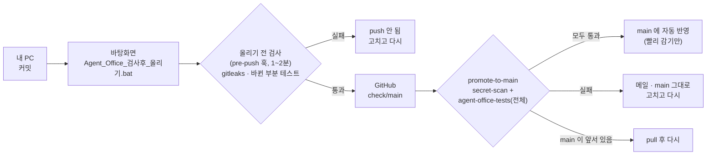

# 올리기 전 검사 — 통과한 것만 main 에

GitHub 에 올리기 전에 두 번 검사한다.

1. **내 PC (push 직전, 1~2분)** — git `pre-push` 훅. 비밀 값 검사와 바뀐 부분 테스트를 한다. 실패하면 push 가 멈춘다.
2. **GitHub (check/main, 15~25분)** — 평소에는 main 대신 `check/main` 으로 올린다. GitHub 가 전체 테스트와 비밀 값 검사를 돌린다. **모두 통과하면** 그 커밋을 main 에 자동으로 올린다(빨리 감기만).

실패해도 main 은 그대로다. 그래서 main 이 빨간 상태가 되지 않는다.



## 처음 한 번 (PC 마다)

이 PC 와 다른 PC 모두 같다. Docker 는 필요 없다.

1. 최신 코드를 받는다: 저장소 폴더(`Project`)에서 `git pull`
2. **`Project\tools\setup_prepush.bat`** 를 더블클릭한다. 하는 일:
   - `git config core.hooksPath .githooks` — 이 저장소에서 push 할 때 검사가 돈다 (이 저장소에만 적용)
   - gitleaks 8.30.1 내려받기 — GitHub 공식 릴리스 zip 을 받아 **SHA256 체크섬**(코드에 고정한 값)을 확인한다. 저장소 밖 `%LOCALAPPDATA%\agent-office-tools\` 에 둔다.
   - pytest·Agent Office 패키지가 있는지 확인한다. 없으면 설치 명령을 알려 준다:
     `python -m pip install -r LLM\Agent_office\requirements-dev.txt`
3. **`Project\tools\Agent_Office_검사후_올리기.bat`** 를 `Project` 폴더 옆(예: `바탕화면\프로젝트\`)에 복사한다.
   - bat 은 자기 옆의 `Project` 폴더를 찾는다. 경로를 적어 두지 않았으므로 다른 PC 에서도 그대로 쓴다.
   - 복사하지 않고 `tools` 안에서 바로 실행해도 된다.
   - 3단계를 잊어도 괜찮다. 이 bat 이 처음 설정(2단계)을 대신 해 준다.

## 평소 순서

1. 평소처럼 커밋한다.
2. **`Agent_Office_검사후_올리기.bat`** 을 실행한다.
   - GitHub 최신 상태를 받아(fetch) 올릴 수 있는지 먼저 본다. 내 main 이 뒤처져 있으면 pull 하라고 하고 멈춘다.
   - `git push origin main:check/main` → 이때 올리기 전 검사가 돈다.
   - 통과하면 GitHub Actions 결과 페이지 주소를 보여 준다.
3. 결과 페이지에서 `promote-to-main` 이 초록이면 main 에 반영된 것이다.
4. 이 PC 는 `Agent_Office_사용버전_갱신.bat` 로 사용 버전을 갱신한다. 다른 PC 는 `git pull` 로 받는다.

> **main 에 직접 push 해도 된다.** 바로 고칠 때 쓴다. 이때도 올리기 전 검사는 돈다. GitHub 검사는 지금처럼 main 에서 돈다.
> 평소에는 check/main 으로 올린다.

## 무엇을 검사하나

| | 내 PC (pre-push 훅) | GitHub (check/main → promote-to-main) |
|---|---|---|
| 비밀 값 | gitleaks 8.30.1, `.gitleaks.toml`, 이번에 올리는 커밋만, 값은 가림(`--redact`) | 같은 버전·설정. main 에 새로 들어갈 커밋 전체 |
| 테스트 | 바뀐 부분만 (아래 규칙) | Agent Office 전체 (리눅스, requirements 범위 안 최신 패키지) |
| 패키지 버전 | 이 PC 와 CI 버전이 다르면 **경고만** | CI 가 최신 허용 버전으로 실제 확인 |
| 실제 모델 호출 | 안 함 (검사 중 API 키 환경 변수를 비움, 테스트는 가짜 모델) | 안 함 (키 없음) |

- Agent Office 밖(`GAME/…`, `LLM/train_set_making_by_rule…` 등)만 바뀐 push 는 Agent Office 테스트를 건너뛴다. 대신 그 폴더에 `tests/` 가 있으면 그 테스트를 돌린다. 그 PC 에 패키지가 없어 못 돌리면 경고만 한다.
- 보내는 커밋이 지금 폴더(HEAD)와 다르거나, 검사할 폴더에 커밋 안 한 변경이 있을 수 있다. 그때는 보내는 커밋을 임시 폴더에 꺼내서 테스트한다. 커밋 안 한 변경 때문에 결과가 달라지지 않게 하기 위해서다.

### 테스트 고르는 규칙 (Agent Office)

| 바뀐 파일 | 돌리는 테스트 |
|---|---|
| `tests/test_x.py` | 그 파일 |
| 파이썬 모듈 `core/feeds.py`, `edu_hobby_ui.py` 등 | **1순위** 이름 짝 `tests/test_feeds.py`(`_ui` 는 떼고도 찾음) · **2순위** 그 모듈을 직접 import 하는 테스트 |
| `config/*` | `tests/test_config.py` · 2순위: 그 파일 이름이 본문에 나오는 테스트 |
| `teams/<팀>/…` | `tests/test_teams.py`, `tests/test_<팀>.py` |
| `app.py`, `tests/conftest.py`·`fakes.py`·`fixtures/`, `requirements*.txt` | 대표 묶음 `tools/prepush/smoke_tests.txt` (설정·팀 정의 전체 + 앱 첫 화면) |
| 문서·그림·`knowledge/` | 없음 |

- 1순위와 대표 묶음은 항상 돌린다. 2순위는 합쳐서 **8개 파일 이하**일 때만 돌린다. 넘으면 실행은 GitHub 에 맡기고, 그 파일들을 모으기만 해서 import 오류를 본다.
- `.github/ci/agent-office-load-sensitive.txt` 의 부하 민감 테스트는 내 PC 에서 돌리지 않는다. 평면도 배치 품질과 동시 실행 시간을 재는 테스트라서, 느린 PC 에서는 코드가 맞아도 떨어질 수 있다. GitHub 이 따로 3번까지 돌린다.
- 규칙 코드: `tools/prepush/select_tests.py` (단위 테스트: `tools/prepush/tests/`)

## 걸리는 시간 (이 PC 에서 잰 값)

측정 조건: 2026-11-05, 이 PC(Windows 11, Python 3.11.9). 다른 작업이 함께 돌던 상태다.

| 경우 | 걸린 시간 |
|---|---|
| 문서만 바뀜 (gitleaks 만) | 측정 중 |
| `core/feeds.py` 한 개 → `test_feeds.py` 30건 | 55초 (gitleaks 1초 + 테스트 48초) |
| `app.py` → 대표 묶음 | 측정 중 |
| 같은 변경 + 전체 모으기(`PREPUSH_COLLECT_ALL=1`) | 측정 중 |
| G2 폴더 → 그 폴더 테스트 | 측정 중 |
| 가짜 키가 든 커밋 → 막힘 | 5초 |
| (참고) Agent Office 전체 테스트 926건 | 15분 53초 |

**사양이 낮은 PC 예상: 위 값의 1.5~2배.** 근거는 다음과 같다.

- 대부분의 시간은 파이썬이 모델 SDK(anthropic·openai·google)와 Streamlit 을 불러오는 데 쓴다. 이 PC 에서 잰 import 시간은 langchain_anthropic 15초, langchain_google_genai 9초, langchain_openai 8초다. 이 시간은 CPU 와 디스크 속도에 거의 비례해서 늘어난다.
- 그래서 전체 테스트 모으기(`pytest --collect-only`, 926건)는 이 PC 에서만 60~70초 걸린다. 1~2분 목표를 넘기 때문에 기본으로는 하지 않는다. 고른 파일과 그 모듈을 import 하는 파일만 모은다.
- 너무 오래 걸리면 `PREPUSH_MAX_FILES=4` 로 2순위 상한을 줄인다.

## 실패했을 때

| 메시지 | 할 일 |
|---|---|
| `비밀 검사: 키·토큰처럼 보이는 값 N개` | **건너뛰지 않는다.** 진짜 키면 발급한 곳에서 폐기하고 커밋에서 뺀다(`git commit --amend` 또는 되돌리기 커밋). 오탐이면 `.gitleaks.toml` 에 파일과 값 모양을 함께 지정해 좁은 예외를 넣는다. 자세한 절차는 [SECURITY.md](../SECURITY.md). |
| `Agent Office 테스트 실패: FAILED tests/…::…` | 그 테스트만 다시 돌려 본다: `cd LLM\Agent_office` → `python -m pytest tests/test_x.py::test_y` |
| `테스트 모으기(import) 오류` | 실행하지 않는 테스트라도 import 가 깨지면 막는다. `ERROR collecting` 아래 줄에 깨진 파일이 나온다. |
| `gitleaks 8.30.1 설치 안 됨` | `tools\setup_prepush.bat` 를 실행한다. |
| GitHub `promote-to-main` 실패 (메일) | 결과 페이지에서 어느 검사가 떨어졌는지 본다. 고쳐서 커밋하고 bat 을 다시 실행한다. main 은 그대로다. |
| `main 이 앞서 있음 — pull 후 다시` | 다른 PC 나 직접 push 로 main 이 바뀐 상태다. `git pull --ff-only origin main` 을 하고 bat 을 다시 실행한다. |
| `.github/workflows/ 를 바꿔서 … 올릴 수 없습니다` | GitHub 기본 토큰은 워크플로 파일을 바꾸는 push 를 할 수 없다. 검사는 통과했으니 PC 에서 `git push origin main` 으로 직접 올린다. |
| bat: `check/main 에 내 main 에 없는 커밋이 있습니다` | 다른 PC 가 올린 것이 검사 중일 수 있다. 그렇다면 `N` 을 누르고 기다린다. 내가 고쳐 쓴(amend) 커밋이면 `y` 를 누른다. 이때 check/main 만 덮어쓰고 main 은 건드리지 않는다. |

## 건너뛰기 (급할 때만)

```
SKIP_PREPUSH=1 git push origin main            # Git Bash
$env:SKIP_PREPUSH=1; git push origin main; Remove-Item Env:SKIP_PREPUSH   # PowerShell
```

건너뛰면 경고가 나온다. GitHub 검사는 그대로 돈다. 비밀 검사에 걸린 것은 건너뛰지 않는다.

## 손으로 검사만 해 보기·옵션

```
python tools/prepush/prepush.py --manual          # 지금 HEAD 중 GitHub 에 없는 커밋을 검사 (push 안 함)
```

| 환경 변수 | 뜻 |
|---|---|
| `PREPUSH_ALL=1` | 2순위 테스트를 상한 없이 모두 돌린다 |
| `PREPUSH_MAX_FILES=8` | 2순위까지 넣을 때의 파일 수 상한 |
| `PREPUSH_COLLECT_ALL=1` | 전체 테스트를 모아 import 오류를 본다 (이 PC +60~70초) |
| `PREPUSH_FULL=1` | Agent Office 전체 테스트 (이 PC 약 16분) |

## GitHub 쪽 설정 메모

- 워크플로: `.github/workflows/promote-to-main.yml` 이 `secret-scan.yml`·`agent-office-tests.yml` 을 그대로 불러 쓴다(`workflow_call`). 검사를 바꾸면 두 흐름에 같이 적용된다.
  - 권한은 기본 `contents: read` 다. main 에 올리는 job 만 `contents: write` 를 쓴다. 토큰은 그 단계의 git 명령 하나에만 넘긴다. 강제 push 는 하지 않는다.
  - Agent Office 가 바뀌지 않은 push 는 agent-office-tests 를 건너뛰고 통과로 본다. 기준은 `agent-office-tests.yml` 의 `paths` 와 같다. 한쪽을 바꾸면 다른 쪽도 함께 바꾼다.
  - 비밀 검사 범위는 'main 에 새로 들어갈 커밋 전체'다. 앞서 실패한 커밋이 다음 push 에 묻어 main 에 들어가지 않게 하기 위해서다.
  - `secret-scan` 은 check/main push 에서 따로 돌지 않는다. promote-to-main 안에서만 돈다. 같은 push 로 검사가 두 번 돌고 실패 메일이 두 통 오는 것을 막기 위해서다.
- PR·Dependabot 은 지금과 같다. main 으로 가는 PR 에서 두 검사가 돌고, 합치는 것은 직접 한다.
- **(선택) main 브랜치 보호**: GitHub → Settings → Rules → Rulesets → New branch ruleset 에서 대상을 `main` 으로 고른다. **Restrict deletions**, **Block force pushes** 만 켜면 직접 push 와 자동 반영은 그대로 되고, main 을 지우거나 강제로 덮어쓰는 것만 막는다. 'Require a pull request'나 'Require status checks'를 켜면 main 직접 push 가 막힌다. 자동 반영(GitHub Actions 토큰)도 막힐 수 있어 지금 흐름과 맞지 않는다.
